# CRM de Atendimento e Orçamentos

**Proposta de especificação e arquitetura do funil de atendimento** — Clean Architecture, DDD e TDD para pequenos negócios que vendem por contato direto (Laboratório de Programação Web, CEFET-MG).

*Modelo de estrutura inspirado em [exemplo/slide/apresentacao-app-estagio-cefet-mg.pdf](../exemplo/slide/apresentacao-app-estagio-cefet-mg.pdf).*

## Sumário

1. [Contexto e escopo](#1--contexto-e-escopo)
2. [Stack tecnológico](#2--stack-tecnológico)
3. [Requisitos funcionais e não funcionais](#3--requisitos-funcionais-e-não-funcionais)
4. [Diagrama de casos de uso](#4--diagrama-de-casos-de-uso)
5. [Diagrama de classes e persistência](#5--diagrama-de-classes-e-persistência)
6. [Modelo entidade-relacionamento](#6--modelo-entidade-relacionamento)
7. [Diagrama de objetos e diagrama de estados](#7--diagrama-de-objetos-e-diagrama-de-estados)
8. [Boundary-Control-Entity](#8--boundary-control-entity)
9. [Diagramas de sequência](#9--diagramas-de-sequência)
10. [Diagrama de atividades](#10--diagrama-de-atividades)
11. [Diagrama de componentes](#11--diagrama-de-componentes)
12. [Decisões de arquitetura e trade-offs](#12--decisões-de-arquitetura-e-trade-offs)
13. [DDD, estrutura de camadas e TDD](#13--ddd-estrutura-de-camadas-e-tdd)
14. [Backlog priorizado por fase](#14--backlog-priorizado-por-fase)
15. [Checklist e rastreabilidade](#15--checklist-e-rastreabilidade)

---

## 1 · Contexto e escopo

Negócios que vendem por contato direto — WhatsApp, ligação, indicação — controlam o atendimento em caderno, planilha ou na própria conversa. O resultado é orçamento esquecido, cliente sem retorno e nenhuma noção de quanto está em aberto.

| Decisão | Resumo |
| --- | --- |
| Público-alvo | Donos de pequenos negócios (ex.: embalagens), atendentes, gestores e administradores do sistema |
| Abordagem | Funil enxuto de 5 estágios com regras que impedem estados inconsistentes |
| Método | UML + DDD + Clean Architecture + TDD |
| Unidade central | `Orcamento` — aggregate root do funil; `Cliente` pode ter vários ao longo do tempo |

**Funil de atendimento:** Novo Contato → Em Negociação → Orçamento Enviado → Fechado, com Perdido acessível a partir de qualquer estágio ativo. Cada Orçamento acumula Interações (mensagem, ligação, reunião) que compõem a linha do tempo do Cliente.

**Fora de escopo:** integração oficial com WhatsApp Business, emissão fiscal/cobrança, catálogo de produtos/estoque/logística, automação de marketing, portal de autoatendimento e app nativo mobile — a validação de transição de estágio vive no domínio, não só na interface.

## 2 · Stack tecnológico

Duas frentes sob Clean Architecture: backend Python/FastAPI e frontend Next.js/TypeScript, com regra de negócio isolável de ambos (RNF03).

| Camada | Escolha | Motivo |
| --- | --- | --- |
| Linguagem backend | Python 3.12+ | Exigência da disciplina; tipagem estrita via mypy |
| Framework web | FastAPI | Validação por Pydantic, OpenAPI automático, assíncrono |
| ORM | SQLAlchemy 2.x | Models separados das entidades de domínio |
| Migrations | Alembic | Versionamento de esquema |
| Banco | PostgreSQL 16 | Requisito da disciplina |
| Testes backend | pytest | Fixtures e parametrização |
| Framework frontend | Next.js (App Router) | Roteamento por pastas, Server Components |
| Linguagem frontend | TypeScript estrito | RNF05, sem `any` |
| Estilo | Tailwind CSS | Consistência sem CSS disperso |
| Componentes | shadcn/ui | Base acessível sobre Radix |
| Drag-and-drop | dnd-kit | Acessível por teclado |
| Testes frontend | Vitest + Testing Library | RNF02 |

Infraestrutura sobe via Docker Compose (RNF09); variáveis sensíveis ficam em `.env`, documentadas em `.env.example`.

## 3 · Requisitos funcionais e não funcionais

### Requisitos funcionais

| ID | Descrição | Prior. | Ator |
| --- | --- | --- | --- |
| RF01 | Registrar novo contato — cria Cliente e Orçamento em "Novo Contato" | Alta | Usuário |
| RF02 | Mover estágio do Orçamento respeitando a sequência do funil | Alta | Usuário |
| RF03 | Impedir "Fechado" sem valor definido | Alta | Usuário |
| RF04 | Registrar Interação (mensagem, ligação, reunião) vinculada a um Orçamento | Alta | Usuário |
| RF05 | Exibir painel Kanban com Orçamentos por estágio | Alta | Usuário |
| RF06 | Calcular métricas do funil (em aberto, taxa de fechamento) | Média | Usuário |
| RF07 | Consultar histórico de Interações do Cliente em ordem cronológica | Média | Usuário |
| RF08 | Permitir múltiplos Orçamentos por Cliente ao longo do tempo | Média | Usuário |
| RF09 | Validar Telefone e Email antes de persistir | Alta | Usuário |
| RF10 | Administrador gerencia outros Usuários | Baixa | Administrador |

### Requisitos não funcionais

| ID | Categoria | Critério |
| --- | --- | --- |
| RNF01 | Desempenho | Painel carrega em < 2s com 500 orçamentos ativos |
| RNF02 | Usabilidade | Mover estágio por drag-and-drop, sem reload; rollback em rejeição |
| RNF03 | Manutenibilidade | Regras de negócio isoláveis de FastAPI e Next.js (Clean Architecture) |
| RNF04 | Confiabilidade | Nenhuma transição inconsistente persistida, mesmo sob falha parcial |
| RNF05 | Portabilidade | Tipagem estrita ponta a ponta (Pydantic/TypeScript), sem `any` |
| RNF06 | Escalabilidade | Use Case depende só de interfaces de repositório |
| RNF07 | Segurança | Rotas autenticadas; gestão de usuários exige perfil Administrador |
| RNF08 | Integridade | `ON DELETE CASCADE` em Interação, `RESTRICT` em Cliente com histórico |
| RNF09 | Portabilidade de ambiente | Navegadores modernos; backend sobe via Docker Compose |
| RNF10 | Rastreabilidade | Todo RF ligado a caso de uso e teste |

RF09 origina os Value Objects `Telefone` e `Email`; RNF03/RNF04/RNF06 orientam diretamente a arquitetura (seção 13).

## 4 · Diagrama de casos de uso

**Atores:** Usuário (primário, inicia quase todos os UCs) e Administrador (especialização — herda tudo do Usuário e adiciona UC10).

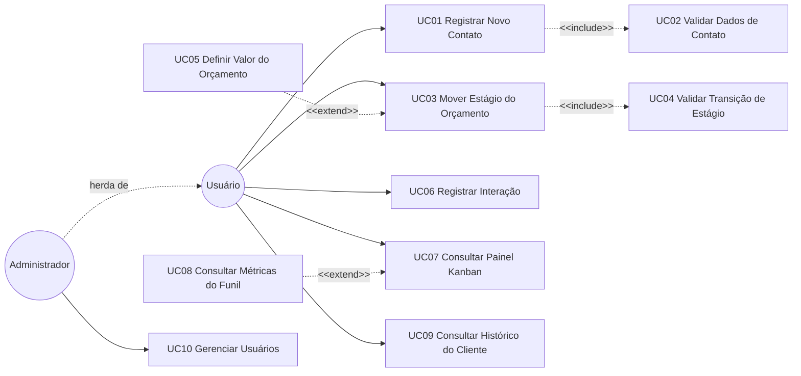

UC01 sempre executa UC02 (include — nenhum Cliente sem validação de telefone/e-mail). UC03 sempre executa UC04. UC05 só ocorre quando a transição exige valor ainda não definido (extend). UC08 estende o painel com métricas, mas o painel funciona sem elas.

### Casos de uso principais

- **UC01 Registrar Novo Contato** — valida dados (UC02), cria Cliente e abre Orçamento em NOVO_CONTATO; formato inválido não persiste nada.
- **UC03 Mover Estágio do Orçamento** — valida a transição (UC04); pode exigir valor (UC05); transição inválida devolve o card à coluna de origem.
- **UC06 Registrar Interação** — associa mensagem/ligação/reunião ao Orçamento com data e hora do sistema.
- **UC07/UC08 Painel Kanban e Métricas** — lista Orçamentos por estágio em < 2s (RNF01) e exibe orçamentos em aberto + taxa de fechamento.
- **UC10 Gerenciar Usuários** — Administrador cria/edita/desativa Usuários; não pode desativar a própria conta.

## 5 · Diagrama de classes e persistência

`Cliente` e `Orcamento` são agregados **separados**, ligados por `cliente_id` — um Cliente pode ter muitos Orçamentos sem carregar todo o histórico a cada movimento de card. `Interacao` existe apenas dentro de `Orcamento` (composição); não há `InteracaoRepository`.

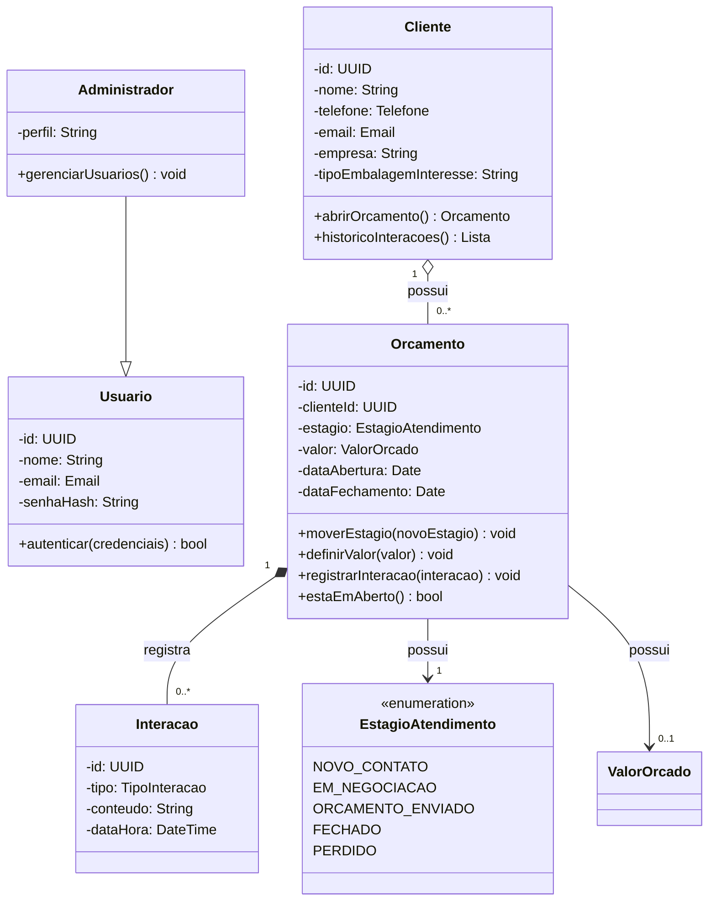

**Value Objects** — imutáveis, validados na construção: `Telefone`, `Email`, `ValorOrcado` (decimal positivo), `EstagioAtendimento` (enum fechado de 5 valores).

### Persistência

| Classe | Persistente? | Estratégia |
| --- | --- | --- |
| Cliente | Sim | Tabela `cliente`, aggregate root |
| Orcamento | Sim | Tabela `orcamento`, FK `cliente_id`, aggregate root do funil |
| Interacao | Sim | Tabela `interacao`, FK `orcamento_id`, delete cascade |
| Usuario / Administrador | Sim | Tabela `usuario`; herança por tabela única via coluna `perfil` |
| EstagioAtendimento | Não (enum) | Coluna `estagio` em `orcamento` |
| Telefone / Email / ValorOrcado | Não (VO) | Colunas embutidas em `cliente` / `orcamento` |

As regras de transição vivem em `Orcamento.moverEstagio()`, nunca em serviço externo ou controller (RNF03/RNF04).

## 6 · Modelo entidade-relacionamento

Derivado direto da tabela de persistência da seção anterior: só classes persistentes viram tabela; Value Objects viram colunas embutidas.

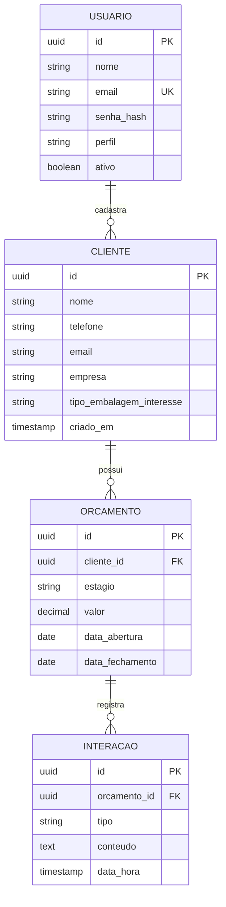

### Restrições de integridade

| Tabela | Restrição | Origem |
| --- | --- | --- |
| `cliente` | `telefone`/`email` NOT NULL, validados na aplicação | RF09 |
| `orcamento` | `estagio` NOT NULL, CHECK entre os 5 valores do enum | RF02 |
| `orcamento` | `valor` NULLABLE — ausência é estado válido | RF03 |
| `orcamento` | FK `cliente_id` com `ON DELETE RESTRICT` | RF08 |
| `interacao` | FK `orcamento_id` com `ON DELETE CASCADE` | Composição |
| `usuario` | `email` UNIQUE | RF10 |

### Índices

`idx_orcamento_estagio`, `idx_orcamento_cliente_id` e `idx_interacao_orcamento_data` sustentam o carregamento do Kanban em < 2s (RNF01) e a ordenação cronológica do histórico (RF07).

**Observação:** a regra "não fechar sem valor" (RF03) **não** é CHECK constraint — vive em `Orcamento.moverEstagio()`, no domínio (RNF04). O banco é a última linha de defesa, não a primeira.

## 7 · Diagrama de objetos e diagrama de estados

### Cenário concreto

Cliente "Embalagens ABC" negociando 500 caixas: 2 interações registradas, valor ainda indefinido — estado válido que a guarda `[valorDefinido]` bloqueia de avançar.

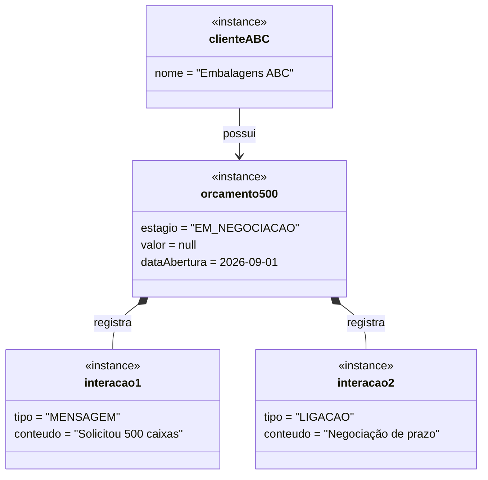

### Máquina de estados do Orçamento

`Orcamento` é a única entidade com ciclo de vida complexo — `Cliente` é criado/atualizado sem status, `Interacao` é registro imutável.

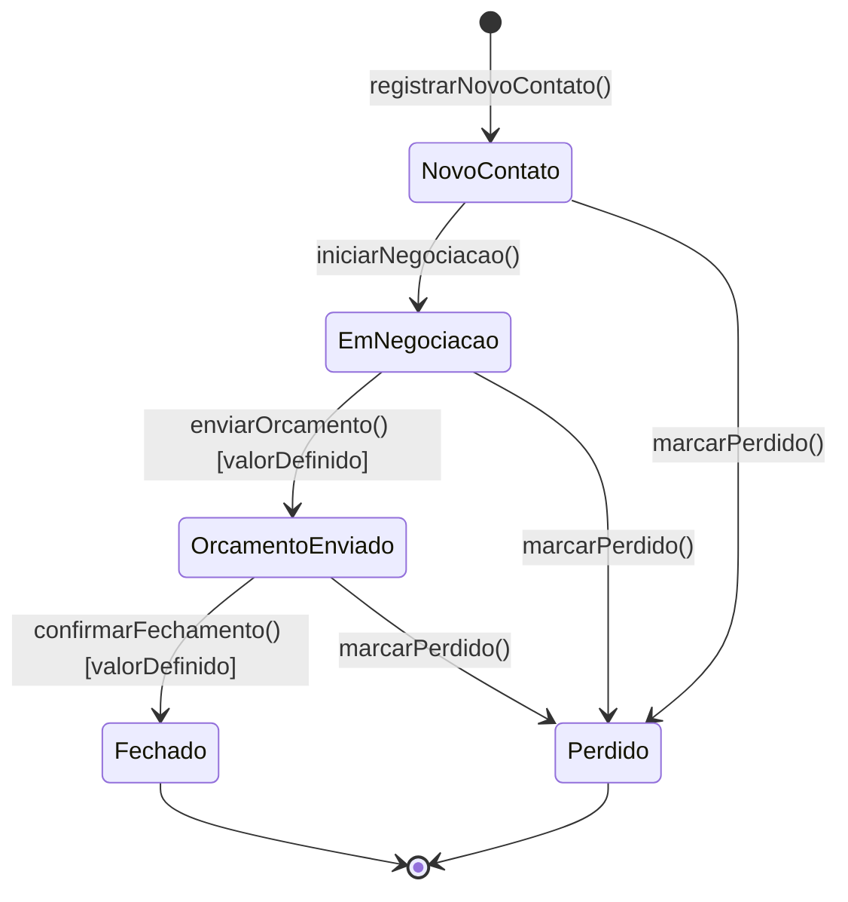

**Transições proibidas:** pular etapa (NOVO_CONTATO → FECHADO), fechar sem valor, reabrir FECHADO/PERDIDO (ambos terminais), retroceder ORCAMENTO_ENVIADO → EM_NEGOCIACAO. Qualquer par fora da tabela é rejeitado com `TransicaoInvalida`. Esta máquina é a fonte de verdade do primeiro teste de unidade do plano de TDD (seção 13).

## 8 · Boundary-Control-Entity

Boundary troca informação com o mundo externo (views Next.js + controllers FastAPI); Control orquestra sem regra de negócio; Entity conhece o domínio.

| Caso de Uso | Boundary | Control | Entities |
| --- | --- | --- | --- |
| UC01 Registrar Novo Contato | `ClienteFormView` / `ClienteController` | `RegistrarNovoContatoUseCase` | Cliente, Orcamento, Telefone, Email |
| UC03 Mover Estágio do Orçamento | `PainelKanbanView` / `OrcamentoController` | `MoverEstagioUseCase` | Orcamento, EstagioAtendimento |
| UC05 Definir Valor do Orçamento | `OrcamentoValorForm` / `OrcamentoController` | `DefinirValorUseCase` | Orcamento, ValorOrcado |
| UC06 Registrar Interação | `InteracaoFormView` / `InteracaoController` | `RegistrarInteracaoUseCase` | Orcamento, Interacao |
| UC07 Consultar Painel Kanban | `PainelKanbanView` / `OrcamentoController` | `ConsultarOrcamentosUseCase` | Orcamento |
| UC08 Consultar Métricas do Funil | `MetricasHeaderView` / `OrcamentoController` | `ConsultarMetricasUseCase` | Orcamento |
| UC09 Consultar Histórico do Cliente | `ClienteTimelineView` / `ClienteController` | `ConsultarHistoricoClienteUseCase` | Cliente, Orcamento, Interacao |
| UC10 Gerenciar Usuários | `UsuariosView` / `UsuarioController` | `GerenciarUsuariosUseCase` | Usuario, Administrador |

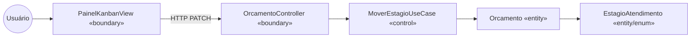

**Regras do mapeamento:** boundary nunca fala com entity diretamente; control não contém regra de negócio (quem sabe quais transições são válidas é `Orcamento`); entity não conhece HTTP, Kanban ou PostgreSQL; há dois boundaries por caso de uso — view no frontend e controller no backend.

## 9 · Diagramas de sequência

### UC03 — Mover Estágio do Orçamento

Caso mais crítico do sistema: é onde RNF04 se manifesta na prática.

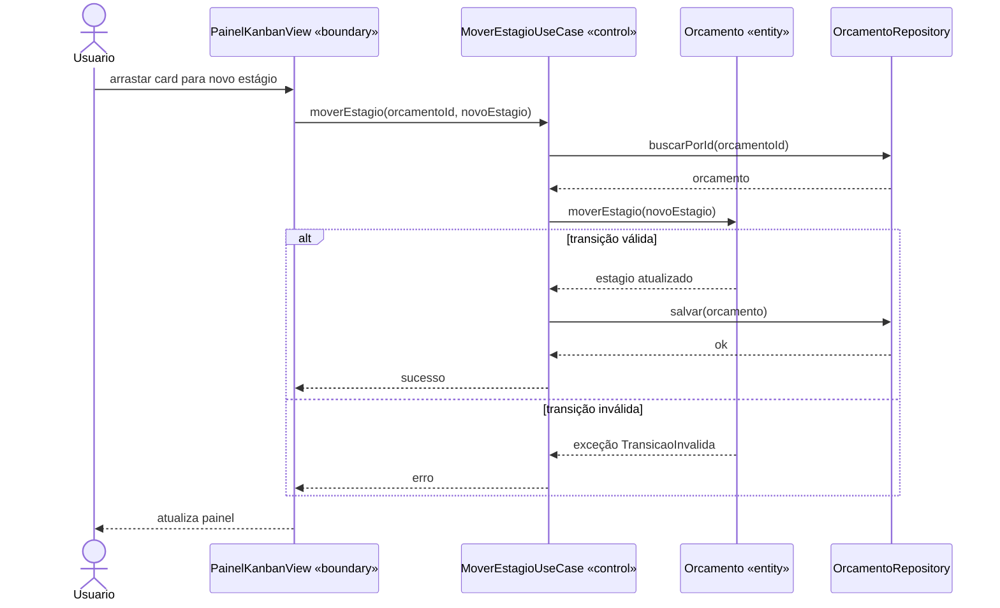

O Use Case não decide nada sobre a transição — carrega o agregado, delega a decisão à entidade e persiste só se ela aceitar (RNF03).

### UC01 — Registrar Novo Contato

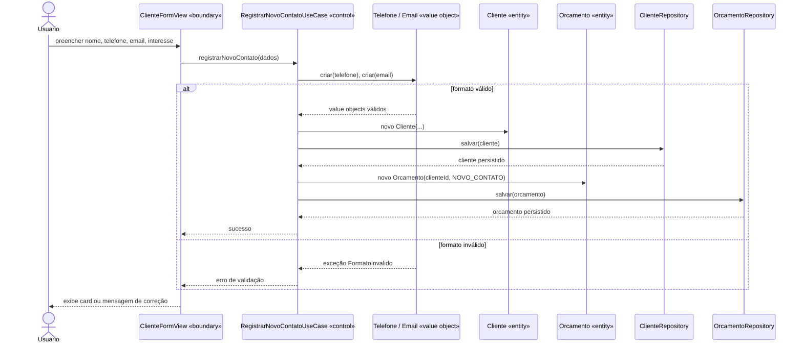

RF09 acontece na construção dos Value Objects, antes de qualquer escrita — telefone inválido significa que nem Cliente nem Orçamento chegam a existir.

### UC06 — Registrar Interação

A Interação é criada e anexada **através** do Orçamento, nunca persistida de forma independente — não existe `InteracaoRepository`, preservando a composição do agregado.

## 10 · Diagrama de atividades

### Fluxo ponta a ponta — do primeiro contato ao fechamento ou perda

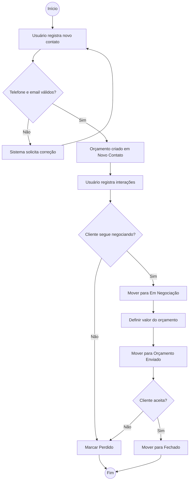

### Raias por responsabilidade — movimentação de card (UC03)

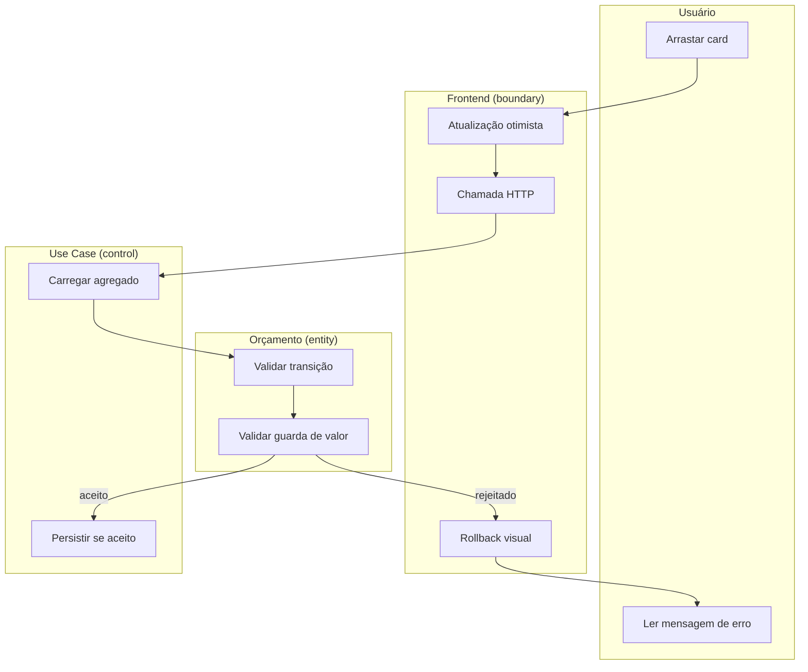

| Decisão | Onde é tomada | Requisito |
| --- | --- | --- |
| Telefone e e-mail válidos? | Value Objects, na construção | RF09 |
| Transição permitida? | `Orcamento.moverEstagio()` | RF02 |
| Valor definido? | Guarda `[valorDefinido]` | RF03 |

Nenhuma decisão de negócio é tomada pelo frontend: ele antecipa o resultado provável (RNF02) e desfaz quando o domínio discorda.

## 11 · Diagrama de componentes

Camadas concêntricas de Clean Architecture. Regra única e inegociável: **as setas apontam sempre para dentro** — o domínio não conhece ninguém; a infraestrutura conhece todo mundo.

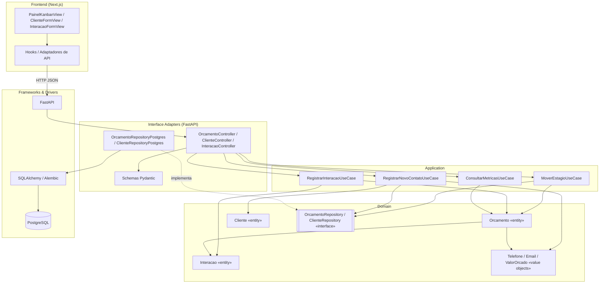

**Regra de verificação (RNF03):** um teste automatizado de arquitetura garante que nenhum import de `sqlalchemy`, `fastapi` ou `pydantic` existe dentro de `domain/` ou `application/` — se aparecer, a build falha.

**Consequência de RNF06:** como cada Use Case depende apenas da interface de repositório, os testes rodam contra um fake in-memory — sem banco, sem container, em milissegundos.

## 12 · Decisões de arquitetura e trade-offs

| Decisão | Justificativa |
| --- | --- |
| Regra de transição no domínio, não na interface | O drag-and-drop é conveniência de UX; mesmo uma chamada direta à API é rejeitada (RNF04) |
| Orcamento como aggregate root do funil | `Interacao` só é acessada via `Orcamento`; sem `InteracaoRepository`, evita interação órfã |
| Cliente e Orcamento como agregados separados | Um Cliente pode ter anos de histórico (RF08); não precisa carregá-lo para mover um card |
| EstagioAtendimento como enum, não tabela | Conjunto fechado e pequeno; evita join em toda consulta do Kanban (RNF01) |
| Clean Architecture em quatro camadas | `domain`/`application`/`adapters`/`infra`, atende RNF03 e RNF06 |
| Tipagem estrita ponta a ponta | Pydantic + TypeScript sem `any` (RNF05); mudança de contrato quebra compilação, não produção |

### Trade-offs aceitos

- Regra no domínio em vez de CHECK constraint ganha testabilidade, mas uma escrita direta no banco poderia burlar a regra — aceito porque o banco não é acessado fora da aplicação.
- Enum de estágio em código exige deploy e migration para adicionar um estágio — aceito porque o funil é intencionalmente fixo.
- Cliente e Orçamento separados exigem duas escritas em UC01, sem transação de agregado único — mitigado com transação de banco no Use Case.

### Principais riscos e mitigações

| Risco | Mitigação |
| --- | --- |
| Regra de transição duplicada no frontend | Frontend consulta mapa de transições exposto pela API, derivado do mesmo enum — nunca reimplementa |
| Desempenho do Kanban com muitos orçamentos | Índice em `estagio`, projeção enxuta no endpoint do painel |
| Vazamento de framework para o domínio | Teste de arquitetura falha a build ao detectar import proibido |
| Estado inconsistente entre UI otimista e backend | Rollback explícito — card volta à origem ao receber `TransicaoInvalida` |
| Scope creep (CRM atrai funcionalidade sem fim) | Escopo negativo registrado no README; qualquer inclusão passa pelo backlog |

## 13 · DDD, estrutura de camadas e TDD

### Agregados e repositórios

| Aggregate Root | Entidades internas | Value Objects | Repository |
| --- | --- | --- | --- |
| Cliente | — | Telefone, Email | ClienteRepository |
| Orcamento | Interacao (composição) | EstagioAtendimento, ValorOrcado | OrcamentoRepository |
| Usuario | — | Email | UsuarioRepository |

Um repositório por aggregate root, nunca por entidade filha. Não há Domain Service neste sistema: UC01 cria dois agregados na mesma operação, mas é coordenação (fica no Use Case), não regra de negócio.

### Estrutura de pastas (backend)

```
backend/src/
  domain/          entities, value_objects, exceptions, repositories (interfaces)
  application/      use_cases (registrar_novo_contato, mover_estagio, registrar_interacao, ...)
  adapters/
    controllers/    routers FastAPI
    repositories/   implementações concretas (Postgres)
    schemas/        Pydantic — entrada e saída
  infra/
    db/             session, models ORM (distintos das entidades!)
    config.py, security.py
  main.py           composition root
```

**Regra de checagem (RNF03):** nenhum import de `sqlalchemy`, `fastapi` ou `pydantic` em `domain/` ou `application/`. **Regra de mapeamento:** models SQLAlchemy são distintos das entidades — reaproveitar o model ORM como entidade quebra a arquitetura inteira.

### Pirâmide de testes (red → green → refactor)

1. **Domínio, sem mock** — `Orcamento.moverEstagio()` rejeita FECHADO sem valor (RF03) e salto de etapa (RF02); primeiro teste do projeto.
2. **Value Objects** — `Telefone`/`Email` recusam formato inválido; `ValorOrcado` recusa zero/negativo (RF09).
3. **Use case com fake in-memory** — `RegistrarNovoContatoUseCase`, `MoverEstagioUseCase` propagando `TransicaoInvalida` sem `salvar()`.
4. **Integração — repositório** — round-trip do agregado com suas interações contra banco de teste.
5. **Integração — rota** — `PATCH /orcamentos/{id}/estagio` retorna 200/422.
6. **Frontend** — drag-and-drop com Testing Library, incluindo rollback visual (RNF02).
7. **Arquitetura** — teste que falha se `domain/`/`application/` importarem framework (RNF03).

Muitos testes unitários de `Orcamento`, Value Objects e Use Cases; poucos de integração; pouquíssimos e2e.

## 14 · Backlog priorizado por fase

A ordem segue a regra de implementação: domínio primeiro, interface por último.

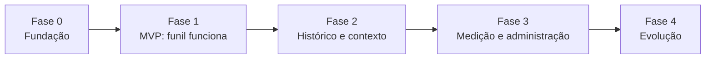

| Fase | Foco | Entregáveis-chave |
| --- | --- | --- |
| 0 — Fundação | Estrutura e guarda-corpos | 4 camadas do backend, teste de arquitetura, Next.js estrito, Docker Compose, CI |
| 1 — MVP | O funil funciona ponta a ponta | Value Objects, `EstagioAtendimento`, `Orcamento.moverEstagio()`, repositórios fake e Postgres, Kanban com drag-and-drop e rollback |
| 2 — Histórico e contexto | Interações e linha do tempo | `Interacao` no agregado, `DefinirValorUseCase`, histórico cronológico do cliente, índices |
| 3 — Medição e administração | Métricas e usuários | `ConsultarMetricasUseCase`, autenticação JWT, perfil Administrador, teste de carga com 500 orçamentos |
| 4 — Evolução (fora do MVP) | Desejável, sem compromisso no semestre | Filtro do Kanban, busca de cliente, lembrete de follow-up, exportação CSV, gráfico de taxa de fechamento |

**Definição de pronto da Fase 1:** é possível registrar um contato e conduzi-lo até Fechado ou Perdido pela interface, com todas as transições inválidas bloqueadas pelo domínio.

**Fora de escopo (não entra no backlog):** integração com WhatsApp Business, emissão fiscal/cobrança, catálogo/estoque/logística, automação de marketing, portal de autoatendimento, app nativo mobile.

## 15 · Checklist e rastreabilidade

✓ Requisitos funcionais e não funcionais · ✓ Diagrama de casos de uso (herança, include/extend) · ✓ Diagrama de classes (agregação, composição) · ✓ Persistência e DER com integridade · ✓ Diagrama de objetos · ✓ Diagrama de estados · ✓ Boundary-Control-Entity · ✓ Diagramas de sequência · ✓ Diagrama de atividades · ✓ Diagrama de componentes (Clean Architecture) · ✓ DDD (aggregates, VOs, repositórios) · ✓ Estrutura de camadas + plano de testes TDD · ✓ Backlog por fase.

### Rastreabilidade RF → Caso de Uso → Teste (amostra)

| RF | Caso de Uso | Teste de aceitação |
| --- | --- | --- |
| RF02 | UC03 Mover Estágio do Orçamento | Unidade — `Orcamento.moverEstagio()` rejeita salto de etapa |
| RF03 | UC03/UC05 | Unidade — guarda `[valorDefinido]`, teste central do sistema |
| RF06 | UC08 Consultar Métricas do Funil | Unidade — cálculo puro, sem banco |
| RF09 | UC02 Validar Dados de Contato | Unidade — `Telefone`, `Email` recusam formato inválido |
| RNF01 | UC07 Consultar Painel Kanban | Teste de carga com 500 orçamentos ativos |
| RNF03 | — | Teste de arquitetura que falha a build ao detectar import proibido |
| RNF04 | UC03 | Testes que confirmam que `salvar()` não é chamado em caso de rejeição |

Matriz completa em [docs/requisitos/](requisitos) e [docs/arquitetura/13-implantacao-ddd-clean-tdd.md](arquitetura/13-implantacao-ddd-clean-tdd.md).
