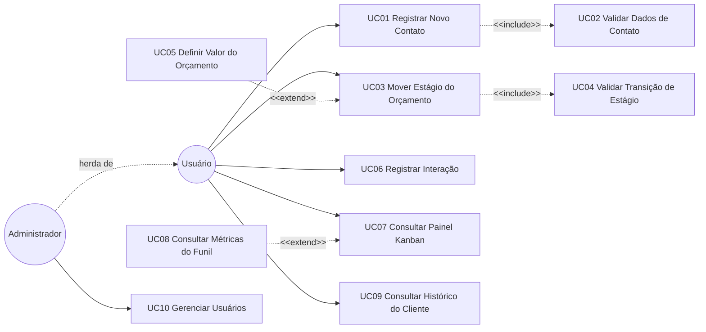

# Casos de Uso

## Atores
- **Usuário** (primário): o dono do negócio ou atendente que opera o CRM. Inicia praticamente todos os casos de uso.
- **Administrador** (primário, especialização): além de tudo que o Usuário faz, gerencia outros usuários do sistema.

**Herança de ator:** `Administrador --|> Usuario` — o Administrador herda todos os casos de uso do Usuário e adiciona `UC10 Gerenciar Usuários`.

## Diagrama de casos de uso

> Leitura: `UC01` **sempre** executa `UC02` (include — nenhum Cliente é criado sem validação de telefone e e-mail). `UC03` **sempre** executa `UC04` (include — nenhuma transição é aplicada sem validação). `UC05` é opcional e só ocorre quando a transição exige valor ainda não definido (extend). `UC08` estende o painel exibindo métricas no topo, mas o painel funciona sem elas (extend).

## Casos de uso principais

### UC01 — Registrar Novo Contato
**Ator:** Usuário
**Pré-condição:** nenhuma

**Fluxo principal:**
1. o Usuário informa nome, telefone, e-mail e tipo de embalagem de interesse;
2. o sistema valida os dados de contato (`UC02`);
3. o sistema cria o Cliente;
4. o sistema cria um Orçamento no estágio "Novo Contato" vinculado ao Cliente.

**Fluxo alternativo:** telefone ou e-mail em formato inválido → o sistema rejeita a operação e solicita correção; nada é persistido.

**Pós-condição:** Cliente e Orçamento persistidos; o card aparece na coluna "Novo Contato".

### UC02 — Validar Dados de Contato
**Ator:** Usuário (incluído por `UC01`)
**Pré-condição:** dados informados

**Fluxo principal:** o sistema valida o formato do Telefone e do Email como Value Objects; a construção falha se o formato for inválido.

**Pós-condição:** Value Objects `Telefone` e `Email` construídos e válidos por definição.

### UC03 — Mover Estágio do Orçamento
**Ator:** Usuário
**Pré-condição:** Orçamento existente

**Fluxo principal:**
1. o Usuário arrasta o card do Orçamento para outro estágio no Kanban;
2. o sistema valida a transição (`UC04`);
3. o sistema atualiza o estágio e persiste.

**Ponto de extensão:** ao mover para "Orçamento Enviado" ou "Fechado", o sistema pode exigir a definição de valor (`UC05`) se ainda não houver.

**Fluxo alternativo:** transição inválida (pular etapa, ou fechar sem valor) → o sistema rejeita e mantém o estágio atual; a interface devolve o card à coluna de origem.

**Pós-condição:** estágio atualizado ou rejeição comunicada, sem estado intermediário persistido.

### UC04 — Validar Transição de Estágio
**Ator:** Usuário (incluído por `UC03`)
**Pré-condição:** estágio de origem e destino conhecidos

**Fluxo principal:** o domínio verifica se a transição pertence ao conjunto permitido pelo diagrama de estados e se a guarda `[valorDefinido]` é satisfeita quando aplicável.

**Pós-condição:** transição aprovada ou exceção `TransicaoInvalida` lançada.

### UC05 — Definir Valor do Orçamento
**Ator:** Usuário (estende `UC03`)
**Pré-condição:** Orçamento existente sem valor definido

**Fluxo principal:** o Usuário informa o valor; o sistema constrói o Value Object `ValorOrcado` e o associa ao Orçamento.

**Fluxo alternativo:** valor negativo ou zero → rejeitado na construção do Value Object.

**Pós-condição:** `Orcamento.valor` definido, liberando as transições guardadas.

### UC06 — Registrar Interação
**Ator:** Usuário
**Pré-condição:** Orçamento existente

**Fluxo principal:**
1. o Usuário seleciona o tipo (mensagem, ligação ou reunião);
2. o Usuário descreve o conteúdo;
3. o sistema associa a Interação ao Orçamento com data e hora.

**Pós-condição:** Interação persistida e disponível na linha do tempo do Cliente.

### UC07 — Consultar Painel Kanban
**Ator:** Usuário
**Pré-condição:** nenhuma

**Fluxo principal:** o sistema lista os Orçamentos agrupados por estágio, em colunas.

**Extensão:** exibir as métricas do funil (`UC08`) no topo do painel.

**Pós-condição:** painel renderizado em menos de 2s com até 500 orçamentos ativos (RNF01).

### UC08 — Consultar Métricas do Funil
**Ator:** Usuário (estende `UC07`)
**Pré-condição:** nenhuma

**Fluxo principal:** o sistema calcula a quantidade de orçamentos em aberto e a taxa de fechamento sobre o conjunto de Orçamentos.

**Pós-condição:** métricas exibidas no cabeçalho do painel.

### UC09 — Consultar Histórico do Cliente
**Ator:** Usuário
**Pré-condição:** Cliente existente

**Fluxo principal:** o sistema reúne as Interações de todos os Orçamentos do Cliente e as ordena cronologicamente.

**Pós-condição:** linha do tempo exibida em ordem cronológica.

### UC10 — Gerenciar Usuários
**Ator:** Administrador
**Pré-condição:** Administrador autenticado

**Fluxo principal:** o Administrador cria, edita ou desativa Usuários do sistema.

**Fluxo alternativo:** tentativa de desativar o próprio usuário → rejeitada.

**Pós-condição:** cadastro de usuários atualizado.
