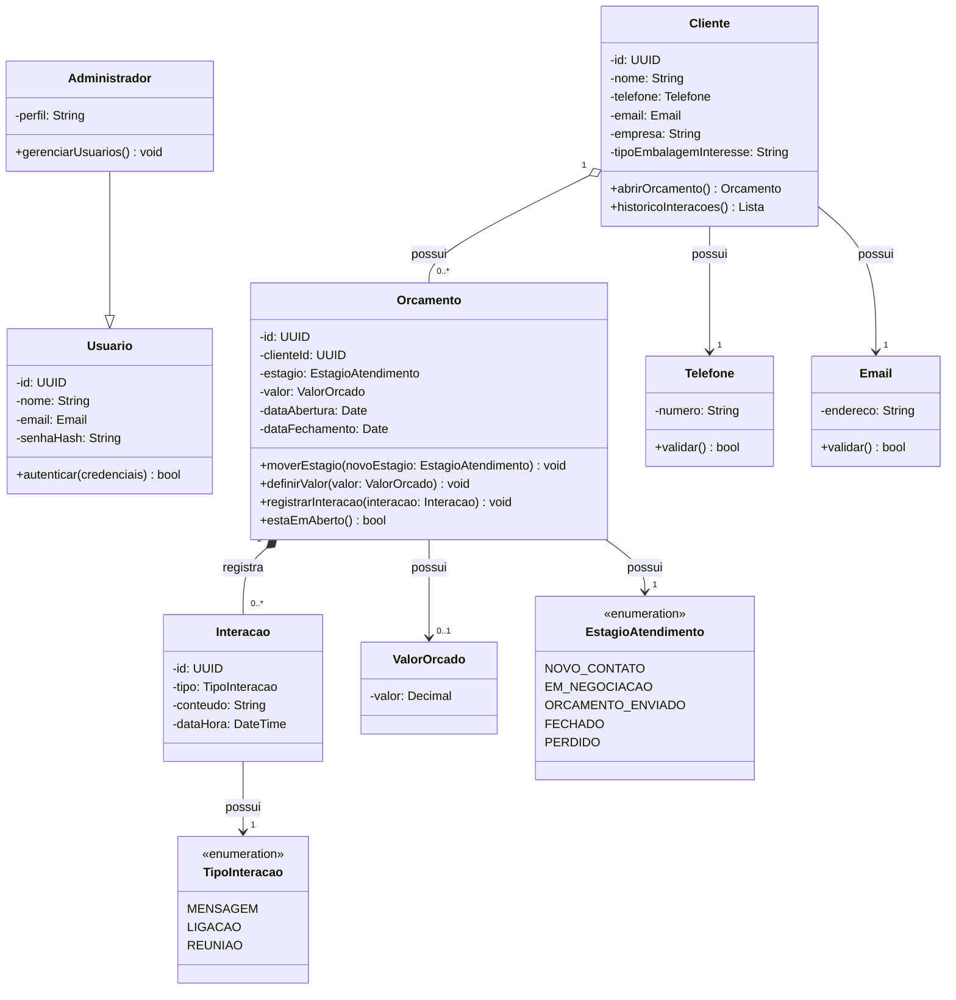

# Diagrama de Classes

## Entidades de domínio

### Cliente
Representa a pessoa ou empresa atendida. **Raiz de agregado** — concentra identidade e dados de contato validados. Pode acumular vários Orçamentos ao longo do tempo (RF08).

### Orcamento
Representa uma oportunidade de venda concreta. **Raiz de agregado** do funil — é a entidade com ciclo de vida complexo e a dona das regras de transição de estágio.

### Interacao
Registro de um contato realizado (mensagem, ligação ou reunião). Existe apenas dentro de um Orçamento — composição.

### Usuario
Operador do sistema. Concentra identidade e credenciais.

### Administrador
Especialização de `Usuario` com permissão para gerenciar outros usuários (RF10).

## Value Objects
- `Telefone` — número validado no formato brasileiro (embutido em `Cliente`);
- `Email` — endereço validado (embutido em `Cliente`);
- `ValorOrcado` — valor decimal positivo em BRL (embutido em `Orcamento`);
- `EstagioAtendimento` — enumeração dos cinco estágios do funil.

Value Objects são imutáveis e comparados por valor, não por identidade. A validação acontece na construção: um `Telefone` inválido não chega a existir (RF09).

## Relacionamentos e multiplicidades
- `Cliente "1" -- "0..*" Orcamento` — **agregação**: o Orçamento tem identidade própria e pode ser consultado fora do Cliente; um Cliente pode existir sem nenhum Orçamento aberto.
- `Orcamento "1" *-- "0..*" Interacao` — **composição**: a Interação não existe sem o Orçamento; excluir o Orçamento exclui suas Interações.
- `Administrador --|> Usuario` — **herança (generalização)**: "é um" Usuario.
- `Orcamento --> "1" EstagioAtendimento` — valor obrigatório embutido.
- `Orcamento --> "0..1" ValorOrcado` — valor opcional; a ausência é justamente o que a guarda `[valorDefinido]` verifica.
- `Cliente --> "1" Telefone` e `Cliente --> "1" Email` — valores obrigatórios embutidos.

## Observações de design
- `Orcamento` é a raiz do agregado do funil: `Interacao` nunca é acessada diretamente de fora, sempre via `Orcamento`.
- As regras de transição vivem em `Orcamento.moverEstagio()`, não em serviço externo nem no controller (RNF03/RNF04).
- `EstagioAtendimento` é enumeração, não tabela — o conjunto de estágios é fechado e conhecido em tempo de compilação.
- `Usuario`/`Administrador` são periféricos ao domínio principal (RF10 é prioridade baixa) e não participam do agregado do funil.

## Persistência

| Classe | Persistente? | Estratégia | Observação |
|--------|-------------|-----------|------------|
| Cliente | Sim | Tabela `cliente`, PK id | Aggregate root |
| Orcamento | Sim | Tabela `orcamento`, PK id, FK cliente_id | Aggregate root do funil |
| Interacao | Sim | Tabela `interacao`, PK id, FK orcamento_id | Composição com Orçamento (delete cascade) |
| Usuario | Sim | Tabela `usuario`, PK id | — |
| Administrador | Sim | Coluna `perfil` em `usuario` | Herança por tabela única |
| EstagioAtendimento | Não (enum) | Coluna `estagio` em `orcamento` | Valor embutido |
| Telefone / Email | Não (value object) | Colunas `telefone` / `email` em `cliente` | Valor imutável |
| ValorOrcado | Não (value object) | Coluna `valor` em `orcamento` | Nullable — a ausência é significativa |

## DER
Ver [05-diagrama-er.md](05-diagrama-er.md) — derivação das tabelas a partir da tabela de persistência acima.
