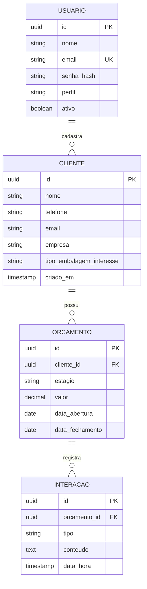

# Diagrama Entidade-Relacionamento (DER)

Derivado da tabela de persistência de [04-diagrama-classes.md](04-diagrama-classes.md). Apenas as classes marcadas como persistentes viram tabela; Value Objects viram colunas embutidas e enumerações viram colunas de texto restrito.

## Conferência com o diagrama de classes
As cardinalidades conferem com [04-diagrama-classes.md](04-diagrama-classes.md):
- Cliente 1 — 0..N Orçamento (agregação);
- Orçamento 1 — 0..N Interação (composição, refletida como `ON DELETE CASCADE`);
- Administrador não é tabela: a especialização é resolvida pela coluna `perfil` em `usuario` (herança por tabela única).

## Restrições de integridade

| Tabela | Restrição | Origem |
|--------|-----------|--------|
| `cliente` | `telefone` e `email` NOT NULL, validados na aplicação antes do INSERT | RF09 |
| `orcamento` | `estagio` NOT NULL, CHECK entre os cinco valores do enum | RF02 |
| `orcamento` | `valor` NULLABLE — a ausência é o estado válido de um orçamento ainda não precificado | RF03 |
| `orcamento` | `data_fechamento` NULLABLE, preenchida apenas em FECHADO ou PERDIDO | RF02 |
| `orcamento` | FK `cliente_id` com `ON DELETE RESTRICT` — não se apaga cliente com histórico | RF08 |
| `interacao` | FK `orcamento_id` com `ON DELETE CASCADE` — composição | Seção 4 |
| `usuario` | `email` UNIQUE | RF10 |

## Índices previstos

| Índice | Justificativa |
|--------|---------------|
| `idx_orcamento_estagio` | O Kanban agrupa por estágio a cada carregamento (RNF01) |
| `idx_orcamento_cliente_id` | Histórico do cliente e listagem de orçamentos por cliente (RF07/RF08) |
| `idx_interacao_orcamento_data` | Linha do tempo ordenada cronologicamente (RF07) |

## Observação sobre a guarda de negócio
A regra "não fechar sem valor" (RF03) **não** é implementada como CHECK constraint. Ela vive em `Orcamento.moverEstagio()`, no domínio, conforme RNF04 — o banco é a última linha de defesa, não a primeira. A CHECK do enum de estágio existe apenas para impedir lixo em escrita direta no banco.
