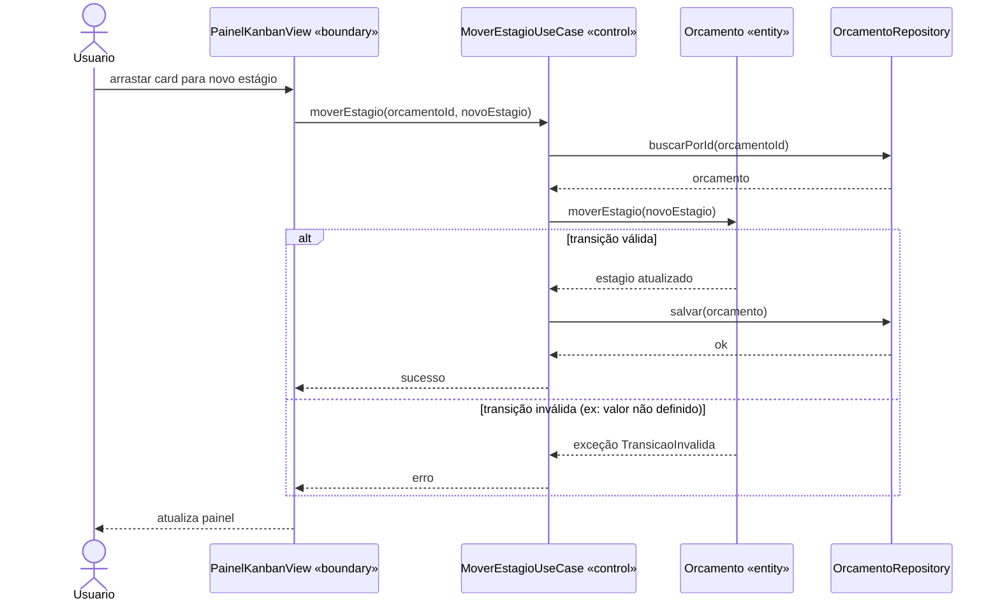
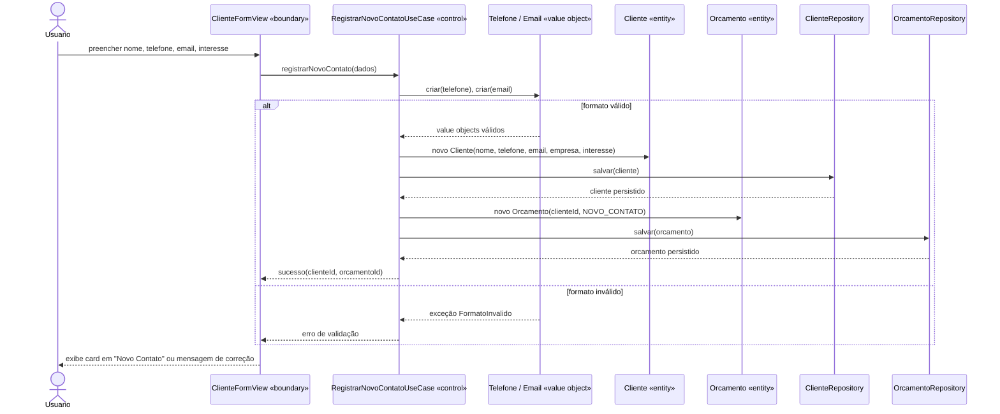
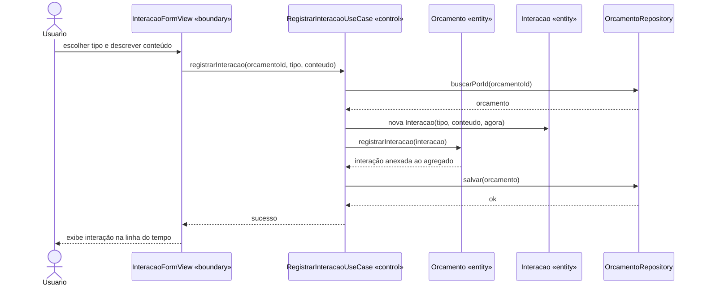

# Diagrama de Sequência

Os fluxos abaixo detalham a colaboração entre as classes de fronteira, controle e entidade mapeadas em [11-boundary-control-entity.md](11-boundary-control-entity.md).

## UC03 — Mover Estágio do Orçamento

Caso mais crítico do sistema: envolve guarda de negócio, e é onde RNF04 se manifesta na prática.

**Leitura:** o Use Case não decide nada sobre a transição — ele apenas carrega o agregado, delega a decisão à entidade e persiste se a entidade aceitar. A regra fica testável sem banco e sem FastAPI (RNF03).

## UC01 — Registrar Novo Contato

**Leitura:** a validação de RF09 acontece na construção dos Value Objects, antes de qualquer escrita. Se o telefone é inválido, nem o Cliente nem o Orçamento chegam a ser criados — não existe estado parcial.

## UC06 — Registrar Interação

**Leitura:** a Interação é criada e anexada **através** do Orçamento, nunca persistida de forma independente. Isso preserva a composição do agregado — não existe `InteracaoRepository`.
