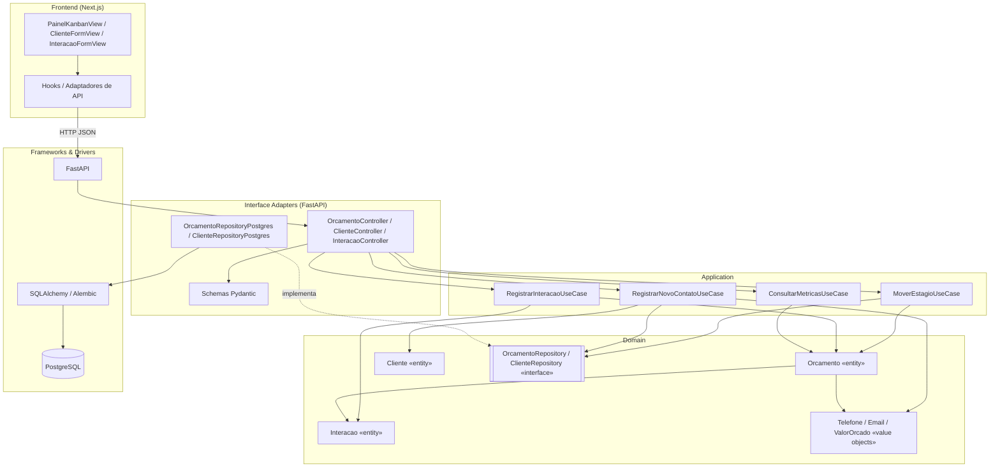

# Diagrama de Componentes

O sistema é organizado em camadas concêntricas de Clean Architecture. A regra de dependência é única e inegociável: **as setas apontam sempre para dentro**. O domínio não conhece ninguém; a infraestrutura conhece todo mundo.

## Componentes e responsabilidades

| Camada | Componente | Responsabilidade | Depende de |
|--------|-----------|------------------|-----------|
| Frontend | `PainelKanbanView` | Renderizar colunas, drag-and-drop, métricas | Hooks |
| Frontend | Hooks / services | Chamar a API, tratar erro, tipar resposta | HTTP |
| Adapters | Controllers | Traduzir HTTP em chamada de Use Case | Application |
| Adapters | Schemas Pydantic | Validar formato de entrada e serializar saída | — |
| Adapters | Repositórios Postgres | Implementar as interfaces do domínio | SQLAlchemy, Domain |
| Application | Use Cases | Orquestrar: carregar agregado, delegar decisão, persistir | Domain (só interfaces) |
| Domain | Entidades e Value Objects | Conter as regras de negócio | Nada |
| Domain | Interfaces de repositório | Declarar o contrato de persistência (ports) | Nada |
| Infra | PostgreSQL, FastAPI, Alembic | Detalhes técnicos substituíveis | — |

## Regra de verificação
Um teste automatizado de arquitetura garante RNF03: **nenhum import de `sqlalchemy`, `fastapi` ou `pydantic` pode existir dentro de `src/domain/` ou `src/application/`**. Se aparecer, a build falha.

## Consequência prática de RNF06
Como cada Use Case depende apenas de `OrcamentoRepository` (interface) e nunca de `OrcamentoRepositoryPostgres`, os testes de use case rodam contra um repositório fake in-memory — sem banco, sem container, em milissegundos. A troca de PostgreSQL por outra tecnologia não toca em uma linha de regra de negócio.
