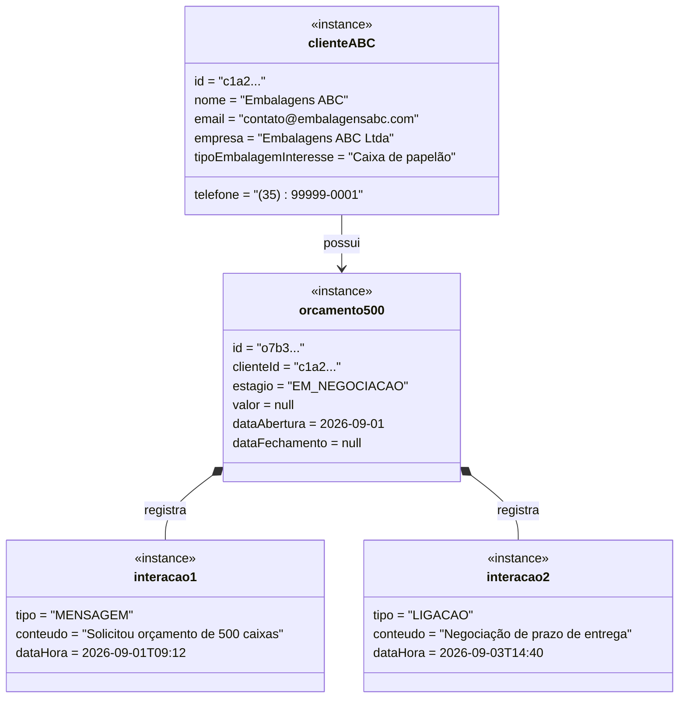
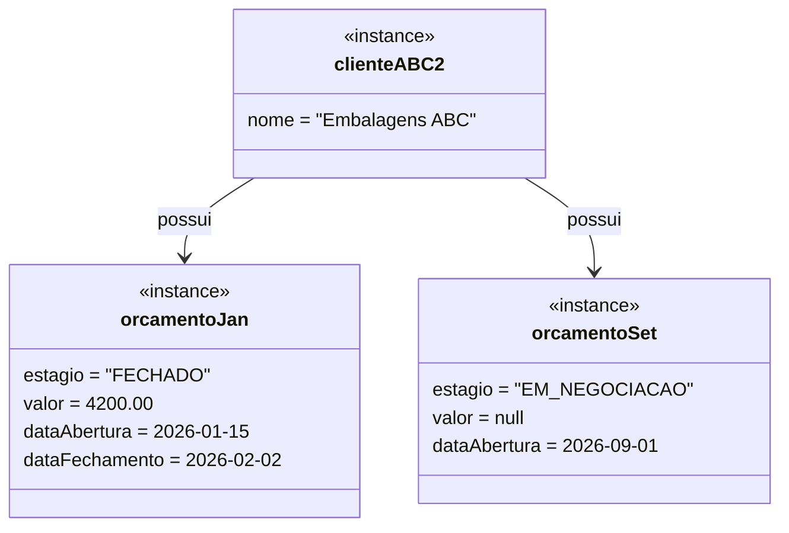

# Diagrama de Objetos

O diagrama de objetos congela um instante do sistema em execução e serve para validar, com instâncias concretas, as multiplicidades declaradas em [04-diagrama-classes.md](04-diagrama-classes.md).

## Cenário
O cliente "Embalagens ABC" está em negociação para um pedido de 500 caixas. Duas interações já foram registradas e o valor ainda não foi definido.

## O que este diagrama valida

| Verificação | Resultado |
|-------------|-----------|
| `Cliente 1 — 0..* Orcamento` | `clienteABC` tem 1 orçamento — dentro de `0..*` |
| `Orcamento 1 — 0..* Interacao` | `orcamento500` tem 2 interações — dentro de `0..*` |
| Composição Orçamento–Interação | `interacao1` e `interacao2` só existem enquanto `orcamento500` existir |
| `Orcamento --> 0..1 ValorOrcado` | `valor = null` é estado válido; é exatamente o que a guarda `[valorDefinido]` bloqueia |
| Tipos do diagrama de classes | `estagio` é valor do enum; `tipo` é valor de `TipoInteracao` |
| RF03 na prática | `orcamento500` **não** pode ir para FECHADO neste instante |

## Cenário complementar: cliente recorrente (RF08)
O mesmo Cliente com dois Orçamentos em momentos diferentes do funil confirma que a agregação `Cliente 1 — 0..*` não é apenas teórica.

`orcamentoJan` demonstra o estado terminal coerente: estágio FECHADO **com** `valor` preenchido e `dataFechamento` definida — o oposto do que RF03 proíbe.
