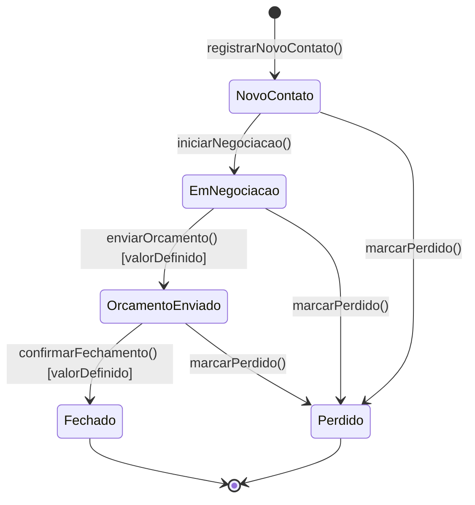

# Diagrama de Estados

## Entidade escolhida
**Orçamento** — atributo `estagio`. É a única entidade do domínio com ciclo de vida complexo:

| Entidade | Tem ciclo de vida complexo? | Justificativa |
|----------|----------------------------|---------------|
| Orcamento | **Sim** | Percorre cinco estágios com transições restritas e guardas de negócio |
| Cliente | Não | É criado e atualizado; não tem status com transições |
| Interacao | Não | É um registro imutável de fato ocorrido |
| Usuario | Não | Apenas ativo/inativo — booleano, não máquina de estados |

## Máquina de estados

## Estados

| Estado | Significado | `valor` | `dataFechamento` |
|--------|-------------|---------|------------------|
| `NOVO_CONTATO` | Oportunidade recém-registrada, ainda sem conversa | opcional | nula |
| `EM_NEGOCIACAO` | Conversa ativa com o cliente | opcional | nula |
| `ORCAMENTO_ENVIADO` | Proposta com valor entregue ao cliente | **obrigatório** | nula |
| `FECHADO` | Venda concretizada — estado terminal | **obrigatório** | preenchida |
| `PERDIDO` | Oportunidade encerrada sem venda — estado terminal | opcional | preenchida |

## Transições

| Origem | Destino | Evento | Guarda |
|--------|---------|--------|--------|
| — | NOVO_CONTATO | `registrarNovoContato()` | — |
| NOVO_CONTATO | EM_NEGOCIACAO | `iniciarNegociacao()` | — |
| EM_NEGOCIACAO | ORCAMENTO_ENVIADO | `enviarOrcamento()` | `[valorDefinido]` |
| ORCAMENTO_ENVIADO | FECHADO | `confirmarFechamento()` | `[valorDefinido]` |
| NOVO_CONTATO / EM_NEGOCIACAO / ORCAMENTO_ENVIADO | PERDIDO | `marcarPerdido()` | — |

## Transições proibidas
Qualquer par origem-destino ausente da tabela acima é rejeitado por `Orcamento.moverEstagio()` com `TransicaoInvalida`. Em particular:

- **pular etapa** — NOVO_CONTATO → ORCAMENTO_ENVIADO ou NOVO_CONTATO → FECHADO (RF02);
- **fechar sem valor** — ORCAMENTO_ENVIADO → FECHADO com `valor` nulo (RF03);
- **reabrir** — FECHADO ou PERDIDO para qualquer outro estado; ambos são terminais;
- **retroceder** — ORCAMENTO_ENVIADO → EM_NEGOCIACAO.

## Rastreabilidade
A guarda `[valorDefinido]` é a tradução direta de **RF03**: `Orcamento.moverEstagio()` rejeita a transição para ORCAMENTO_ENVIADO ou FECHADO se o Value Object `ValorOrcado` não estiver definido. A restrição de sequência é a tradução de **RF02**.

Esta máquina de estados é a fonte de verdade para:
- o teste de unidade número 1 do plano de TDD ([13-implantacao-ddd-clean-tdd.md](13-implantacao-ddd-clean-tdd.md));
- o mapa de colunas que o Kanban usa para dar feedback visual de drop válido;
- o `alt` do diagrama de sequência de UC03 ([06-diagrama-sequencia.md](06-diagrama-sequencia.md)).
