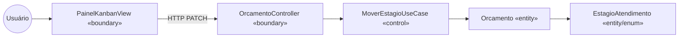
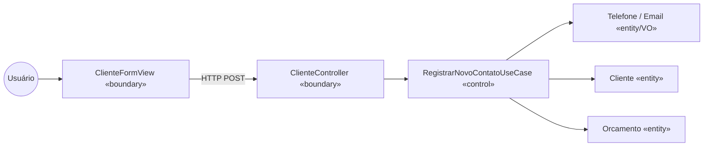

# Classes de Fronteira, Controle e Entidade (Boundary-Control-Entity)

O padrão BCE separa três responsabilidades por caso de uso:

- **Boundary** — tudo que troca informação com o mundo externo (telas do Next.js e controllers do FastAPI);
- **Control** — a orquestração do caso de uso; não contém regra de negócio, apenas coordena;
- **Entity** — o conhecimento do domínio; onde as regras realmente moram.

## Mapeamento por caso de uso

| Caso de Uso | Boundary | Control | Entities envolvidas |
|-------------|----------|---------|---------------------|
| UC01 Registrar Novo Contato | `ClienteFormView` (Next.js) / `ClienteController` (FastAPI) | `RegistrarNovoContatoUseCase` | Cliente, Orcamento, Telefone, Email |
| UC03 Mover Estágio do Orçamento | `PainelKanbanView` (Next.js) / `OrcamentoController` (FastAPI) | `MoverEstagioUseCase` | Orcamento, EstagioAtendimento |
| UC05 Definir Valor do Orçamento | `OrcamentoValorForm` (Next.js) / `OrcamentoController` (FastAPI) | `DefinirValorUseCase` | Orcamento, ValorOrcado |
| UC06 Registrar Interação | `InteracaoFormView` (Next.js) / `InteracaoController` (FastAPI) | `RegistrarInteracaoUseCase` | Orcamento, Interacao |
| UC07 Consultar Painel Kanban | `PainelKanbanView` (Next.js) / `OrcamentoController` (FastAPI) | `ConsultarOrcamentosUseCase` | Orcamento |
| UC08 Consultar Métricas do Funil | `MetricasHeaderView` (Next.js) / `OrcamentoController` (FastAPI) | `ConsultarMetricasUseCase` | Orcamento |
| UC09 Consultar Histórico do Cliente | `ClienteTimelineView` (Next.js) / `ClienteController` (FastAPI) | `ConsultarHistoricoClienteUseCase` | Cliente, Orcamento, Interacao |
| UC10 Gerenciar Usuários | `UsuariosView` (Next.js) / `UsuarioController` (FastAPI) | `GerenciarUsuariosUseCase` | Usuario, Administrador |

## Exemplo detalhado — UC03

## Exemplo detalhado — UC01

## Regras do mapeamento

1. **Boundary nunca fala com Entity diretamente.** O controller não instancia `Orcamento`; ele chama o Use Case.
2. **Control não contém regra de negócio.** `MoverEstagioUseCase` não sabe quais transições são válidas — quem sabe é `Orcamento`.
3. **Entity não conhece Boundary nem Control.** `Orcamento` não sabe que existe HTTP, Kanban ou PostgreSQL.
4. **Há dois boundaries por caso de uso**, um em cada ponta: a view no frontend e o controller no backend. Ambos são fronteira com o mundo externo.

## Correspondência com as camadas
O BCE mapeia diretamente na estrutura de pastas de [13-implantacao-ddd-clean-tdd.md](13-implantacao-ddd-clean-tdd.md):

| BCE | Camada Clean Architecture | Pasta |
|-----|--------------------------|-------|
| Boundary (frontend) | Frameworks & Drivers | `frontend/src/app`, `frontend/src/components` |
| Boundary (backend) | Interface Adapters | `backend/src/adapters/controllers` |
| Control | Application | `backend/src/application/use_cases` |
| Entity | Domain | `backend/src/domain/entities`, `backend/src/domain/value_objects` |
