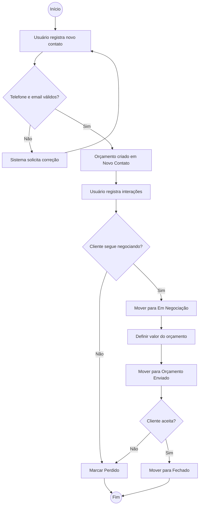
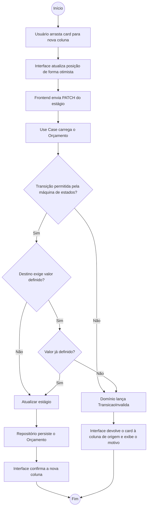
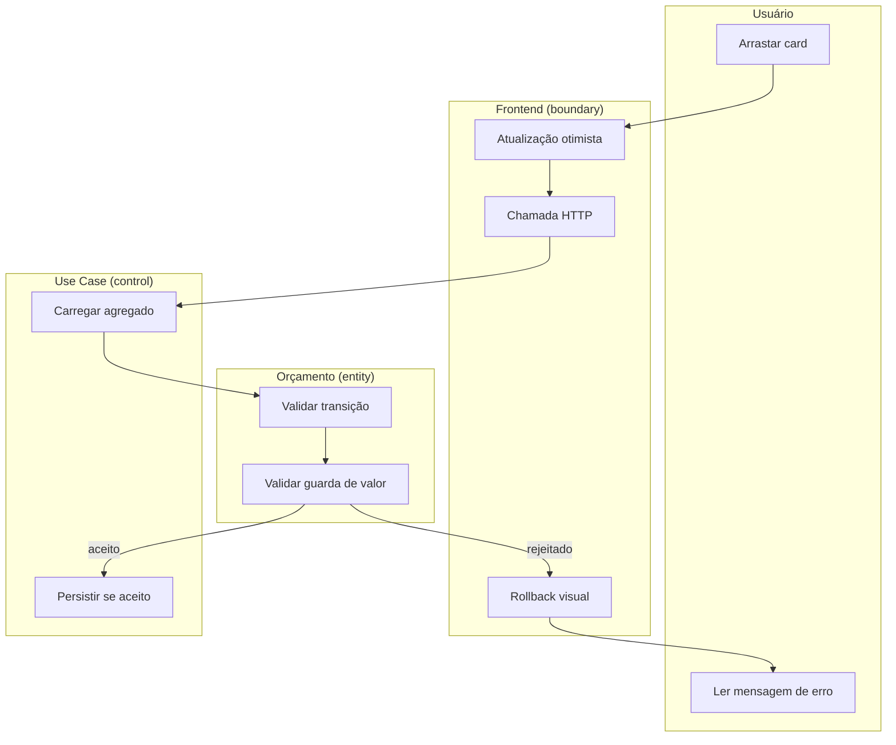

# Diagrama de Atividades

## Fluxo principal — do primeiro contato ao fechamento ou perda

Processo ponta a ponta do negócio, atravessando UC01, UC03, UC05 e UC06.

## Fluxo detalhado — movimentação de card no Kanban (UC03)

Mostra o tratamento de erro exigido por RNF02 (sem recarregar a página) e RNF04 (rejeição no domínio).

## Raias por responsabilidade

## Pontos de decisão relevantes

| Decisão | Onde é tomada | Requisito |
|---------|---------------|-----------|
| Telefone e e-mail válidos? | Value Objects `Telefone` e `Email`, na construção | RF09 |
| Transição permitida? | `Orcamento.moverEstagio()` | RF02 |
| Valor definido? | Guarda `[valorDefinido]` em `Orcamento.moverEstagio()` | RF03 |
| Cliente segue negociando? | Usuário — decisão de negócio, não do sistema | — |
| Cliente aceita? | Usuário — decisão de negócio, não do sistema | — |

Nenhuma decisão de negócio é tomada pelo frontend. Ele apenas antecipa o resultado provável para não travar a interface, e desfaz quando o domínio discorda.
