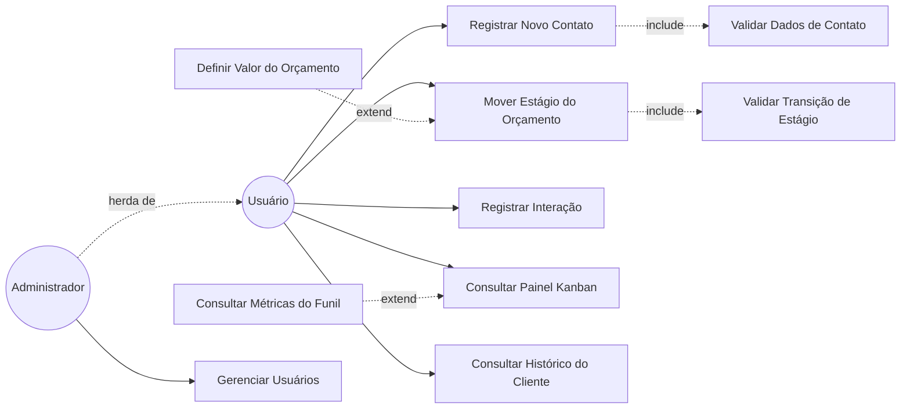
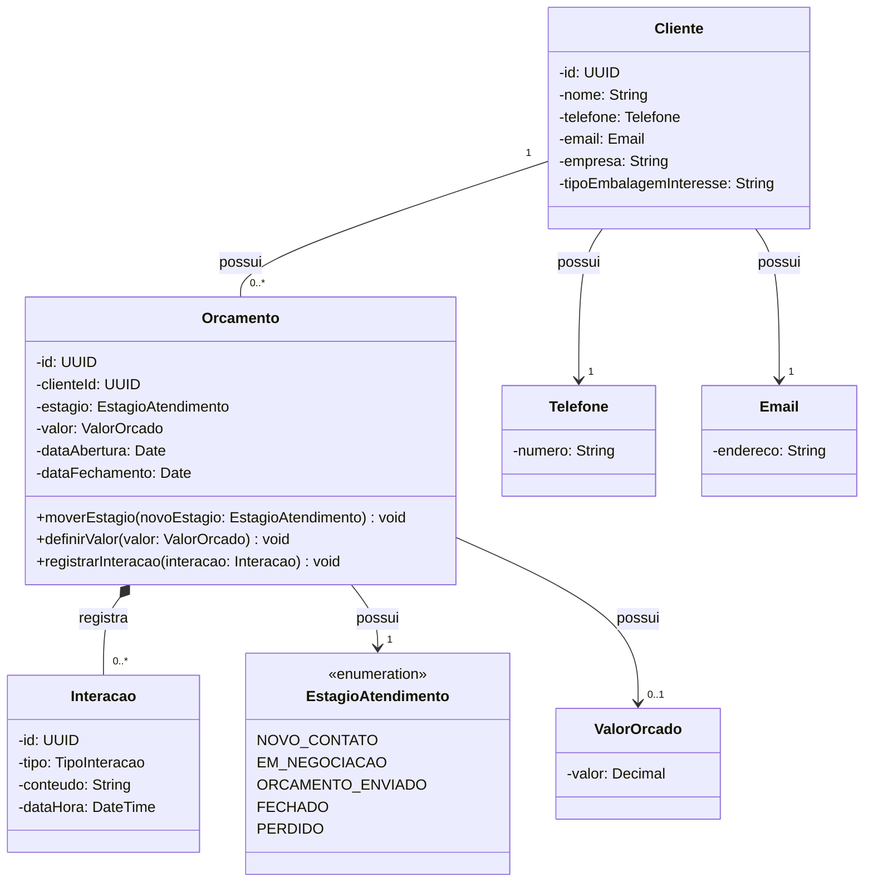
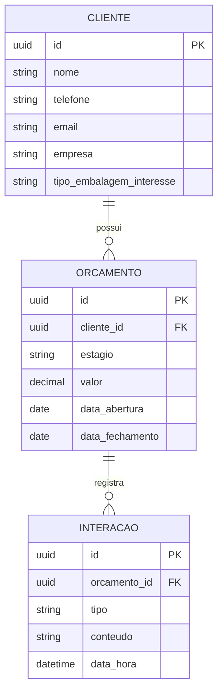
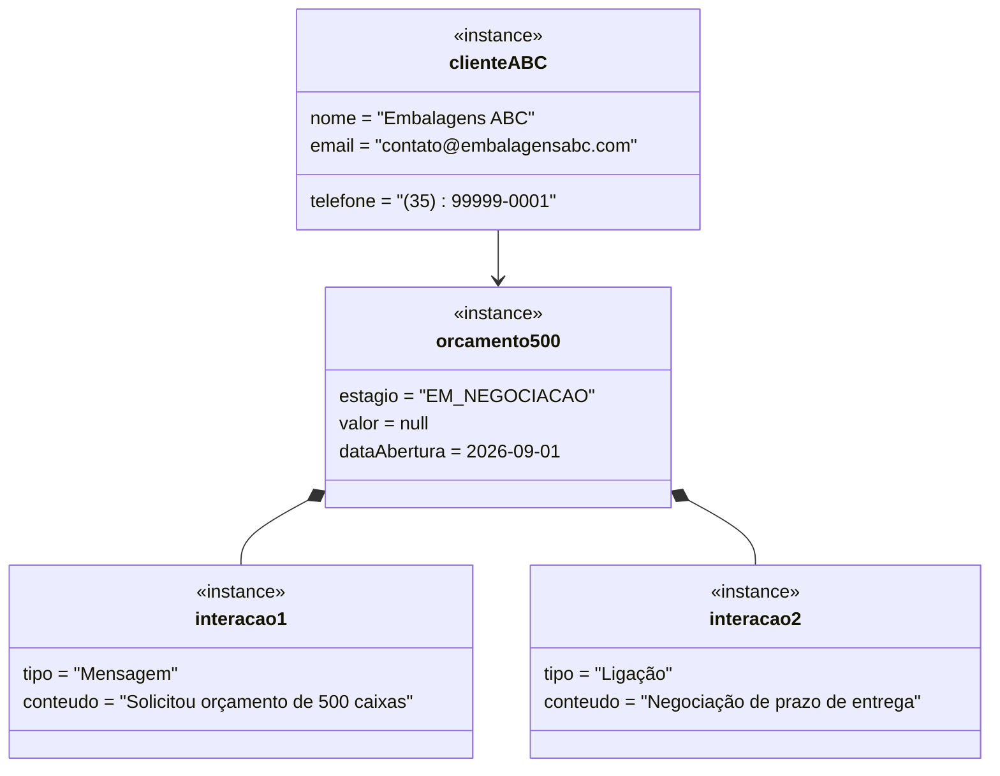
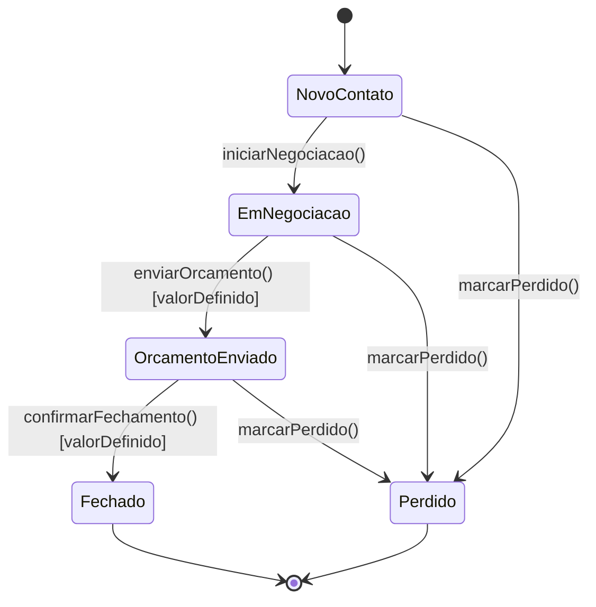
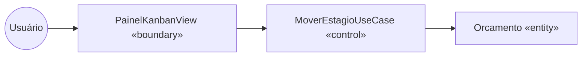
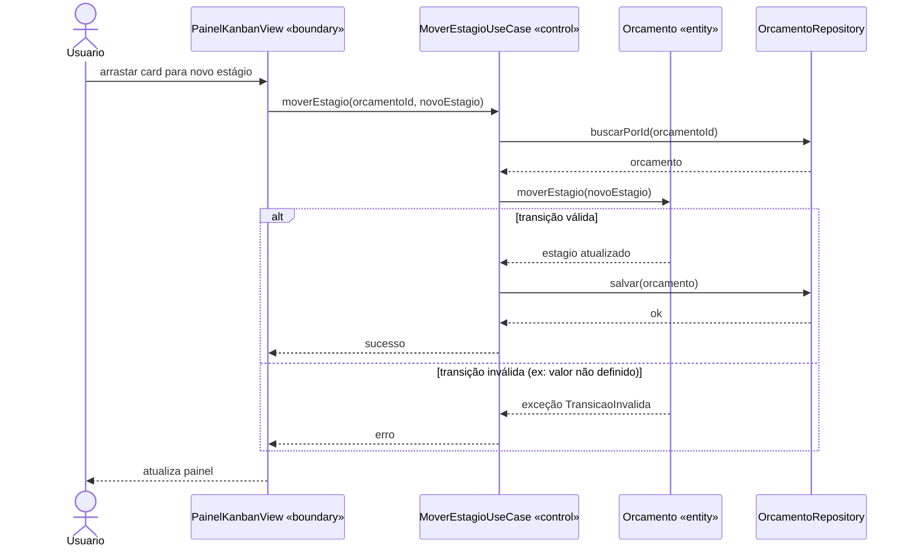
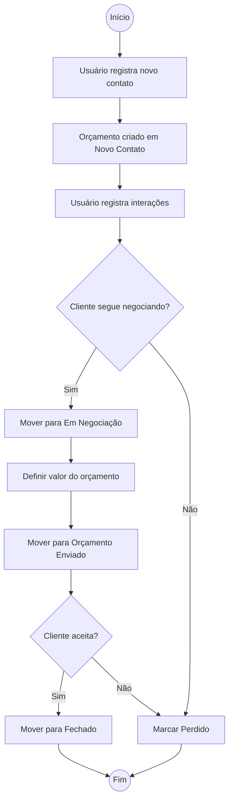
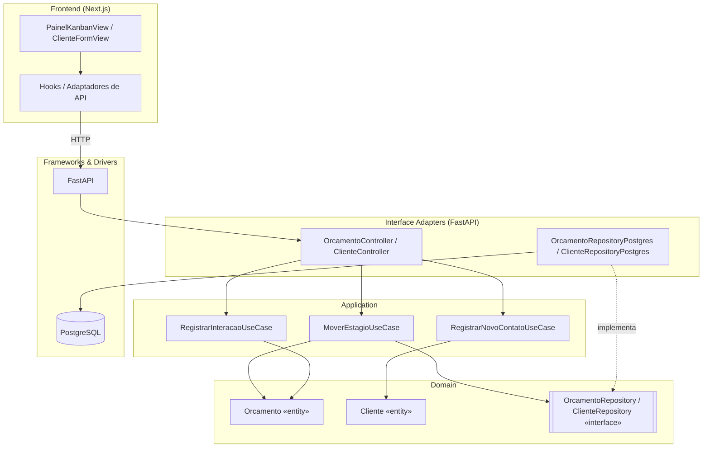

# Documento de Análise e Projeto de Software — CRM de Atendimento e Orçamentos

**Disciplina:** Laboratório de Programação Web (G08LPWE0.01) — CEFET-MG
**Domínio:** CRM para pequenos negócios que vendem por contato direto (WhatsApp, ligação, indicação), como uma empresa de embalagens.
**Stack:** Backend FastAPI + PostgreSQL | Frontend Next.js + TypeScript + Tailwind + shadcn/ui | Clean Architecture + DDD + TDD

---

> **Versão consolidada.** Este arquivo reúne todas as seções da análise e projeto em um único documento, para entrega da disciplina.
> A mesma matéria está dividida por seção em [`docs/arquitetura/`](arquitetura), que é a referência usada no dia a dia da implementação:
>
> | Seção deste documento | Arquivo correspondente |
> |---|---|
> | 1. Levantamento de Requisitos | [02-requisitos-crm.md](arquitetura/02-requisitos-crm.md) · [requisitos/](requisitos) |
> | 2. Diagrama de Casos de Uso | [03-casos-de-uso.md](arquitetura/03-casos-de-uso.md) |
> | 3. Diagrama de Classes | [04-diagrama-classes.md](arquitetura/04-diagrama-classes.md) |
> | 3.1 Diagrama Entidade-Relacionamento | [05-diagrama-er.md](arquitetura/05-diagrama-er.md) |
> | 4. Diagrama de Objetos | [09-diagrama-objetos.md](arquitetura/09-diagrama-objetos.md) |
> | 5. Diagrama de Estados | [10-diagrama-estados.md](arquitetura/10-diagrama-estados.md) |
> | 6. Boundary-Control-Entity | [11-boundary-control-entity.md](arquitetura/11-boundary-control-entity.md) |
> | 7. Diagrama de Sequência | [06-diagrama-sequencia.md](arquitetura/06-diagrama-sequencia.md) |
> | 8. Diagrama de Atividades | [12-diagrama-atividades.md](arquitetura/12-diagrama-atividades.md) |
> | 9. Diagrama de Componentes | [07-diagrama-componentes.md](arquitetura/07-diagrama-componentes.md) |
> | 10. DDD, Clean Architecture e TDD | [13-implantacao-ddd-clean-tdd.md](arquitetura/13-implantacao-ddd-clean-tdd.md) |
>
> Visão de produto e decisões de arquitetura, que não têm seção própria aqui, estão em
> [01-visao-produto.md](arquitetura/01-visao-produto.md) e [08-decisao-arquitetura.md](arquitetura/08-decisao-arquitetura.md).

---

## 1. Levantamento de Requisitos

### Requisitos Funcionais (RF)

| ID | Descrição | Prioridade | Ator/Origem |
|----|-----------|-----------|-------------|
| RF01 | Sistema deve permitir que o Usuário registre um novo contato, criando um Cliente e um Orçamento no estágio "Novo Contato" | Alta | Usuário |
| RF02 | Sistema deve permitir que o Usuário mova o estágio de um Orçamento respeitando a sequência Novo Contato → Em Negociação → Orçamento Enviado → Fechado/Perdido | Alta | Usuário |
| RF03 | Sistema deve impedir que um Orçamento seja marcado como "Fechado" sem um valor definido | Alta | Usuário |
| RF04 | Sistema deve permitir que o Usuário registre uma Interação (mensagem, ligação ou reunião) vinculada a um Orçamento | Alta | Usuário |
| RF05 | Sistema deve exibir um painel Kanban com os Orçamentos organizados por estágio | Alta | Usuário |
| RF06 | Sistema deve calcular métricas simples do funil: quantidade de orçamentos em aberto e taxa de fechamento | Média | Usuário |
| RF07 | Sistema deve permitir consultar o histórico de Interações de um Cliente em ordem cronológica | Média | Usuário |
| RF08 | Sistema deve permitir que um Cliente tenha múltiplos Orçamentos ao longo do tempo | Média | Usuário |
| RF09 | Sistema deve validar Telefone e Email do Cliente no formato correto antes de persistir | Alta | Usuário |
| RF10 | Sistema deve permitir que um Administrador gerencie outros Usuários do sistema | Baixa | Administrador |

### Requisitos Não Funcionais (RNF)

| ID | Descrição | Prioridade | Ator/Origem |
|----|-----------|-----------|-------------|
| RNF01 | Desempenho: o painel Kanban deve carregar em < 2s com até 500 orçamentos ativos | Alta | Equipe |
| RNF02 | Usabilidade: mover um Orçamento entre estágios deve ser feito por drag-and-drop, sem recarregar a página | Alta | Equipe |
| RNF03 | Manutenibilidade: regras de negócio (transições de estágio, cálculo de métricas) devem ser isoláveis de FastAPI e Next.js (Clean Architecture) | Alta | Equipe |
| RNF04 | Confiabilidade: nenhuma transição de estágio inconsistente deve ser persistida, mesmo sob falha parcial (validação no domínio, não só na UI) | Alta | Equipe |
| RNF05 | Portabilidade: tipagem estrita de ponta a ponta (Pydantic no backend, TypeScript no frontend), sem uso de tipos genéricos (`any`) | Média | Equipe |
| RNF06 | Escalabilidade: cada Caso de Uso deve depender apenas de interfaces de repositório, permitindo troca de implementação sem alterar regra de negócio | Média | Equipe |

Cada RF vira candidato a caso de uso na seção 2. RNF03/RNF04/RNF06 orientam diretamente a arquitetura da seção 10; RNF05 orienta a tipagem das entidades e schemas (seção 3 e 10); RF09 origina os Value Objects `Telefone` e `Email`.

---

## 2. Diagrama de Casos de Uso

**Atores:**
- **Usuário** (primário): o dono do negócio ou atendente que opera o CRM.
- **Administrador** (herda de Usuário): além de tudo que o Usuário faz, gerencia outros usuários do sistema.



### Descrição textual dos casos de uso principais

**UC01 — Registrar Novo Contato**
- Ator: Usuário
- Pré-condição: nenhuma
- Fluxo principal: Usuário informa nome, telefone, email e tipo de embalagem de interesse → sistema valida dados (UC02) → sistema cria Cliente → sistema cria Orçamento no estágio "Novo Contato" vinculado ao Cliente
- Fluxo alternativo: telefone/email inválido → sistema rejeita e solicita correção
- Pós-condição: Cliente e Orçamento persistidos

**UC03 — Mover Estágio do Orçamento**
- Ator: Usuário
- Pré-condição: Orçamento existente
- Fluxo principal: Usuário arrasta o card do Orçamento para outro estágio no Kanban → sistema valida a transição (UC04) → sistema atualiza o estágio
- Ponto de extensão: ao mover para "Orçamento Enviado", sistema pode exigir definição de valor (UC05) se ainda não houver
- Fluxo alternativo: transição inválida (ex: pular etapa) → sistema rejeita e mantém estágio atual
- Pós-condição: estágio atualizado ou rejeição registrada

**UC06 — Registrar Interação**
- Ator: Usuário
- Pré-condição: Orçamento existente
- Fluxo principal: Usuário seleciona tipo (mensagem/ligação/reunião), descreve o conteúdo → sistema associa a Interação ao Orçamento com data/hora
- Pós-condição: Interação persistida, disponível na linha do tempo do Cliente

**UC07 — Consultar Painel Kanban**
- Ator: Usuário
- Pré-condição: nenhuma
- Fluxo principal: sistema lista Orçamentos agrupados por estágio
- Extensão: exibir métricas do funil (UC08) no topo do painel

---

## 3. Diagrama de Classes



**Persistência:**

| Classe | Persistente? | Estratégia | Observação |
|--------|-------------|-----------|------------|
| Cliente | Sim | Tabela `cliente`, PK id | — |
| Orcamento | Sim | Tabela `orcamento`, FK cliente_id | Aggregate Root |
| Interacao | Sim | Tabela `interacao`, FK orcamento_id | Composição com Orçamento |
| EstagioAtendimento | Não (enum) | Coluna `estagio` em `orcamento` | Valor embutido |
| Telefone / Email / ValorOrcado | Não (VO) | Colunas embutidas no dono | Value Objects |

### 3.1 Diagrama Entidade-Relacionamento (DER)



Cardinalidades conferem com o diagrama de classes (seção 3): Cliente 1—N Orçamento, Orçamento 1—N Interação (composição).

---

## 4. Diagrama de Objetos

Cenário: cliente "Embalagens ABC" com um orçamento em negociação e duas interações registradas.



Confirma que `interacao1`/`interacao2` só existem enquanto `orcamento500` existir (composição) e que `estagio`/`valor` seguem os tipos do diagrama de classes.

---

## 5. Diagrama de Estados

Entidade com ciclo de vida complexo: **Orçamento** (atributo `estagio`), única entidade candidata no domínio — Cliente e Interação não têm transições de status.



A guarda `[valorDefinido]` implementa RF03: `Orcamento.moverEstagio()` rejeita a transição para "Orçamento Enviado" ou "Fechado" se `ValorOrcado` não estiver definido.

---

## 6. Classes de Fronteira, Controle e Entidade (Boundary-Control-Entity)

| Caso de Uso | Boundary | Control | Entities envolvidas |
|-------------|----------|---------|---------------------|
| Registrar Novo Contato | ClienteFormView (Next.js) / ClienteController (FastAPI) | RegistrarNovoContatoUseCase | Cliente, Orcamento |
| Mover Estágio do Orçamento | PainelKanbanView (Next.js) / OrcamentoController (FastAPI) | MoverEstagioUseCase | Orcamento |
| Registrar Interação | InteracaoFormView (Next.js) / InteracaoController (FastAPI) | RegistrarInteracaoUseCase | Orcamento, Interacao |
| Consultar Painel Kanban | PainelKanbanView (Next.js) / OrcamentoController (FastAPI) | ConsultarOrcamentosUseCase, ConsultarMetricasUseCase | Orcamento |
| Gerenciar Usuários | UsuariosView (Next.js) / UsuarioController (FastAPI) | GerenciarUsuariosUseCase | Usuario |



---

## 7. Diagrama de Sequência

**UC03 — Mover Estágio do Orçamento** (caso mais crítico, envolve guarda de negócio):



---

## 8. Diagrama de Atividades

Processo ponta a ponta: do primeiro contato até o fechamento ou perda do atendimento.



---

## 9. Diagrama de Componentes



---

## 10. Implementação: DDD, Clean Architecture, TDD

### DDD

| Aggregate Root | Entidades internas | Value Objects | Repository |
|-----------------|--------------------|--------------|-------------|
| Cliente | — | Telefone, Email | ClienteRepository |
| Orcamento | Interacao | EstagioAtendimento, ValorOrcado | OrcamentoRepository |

Linguagem ubíqua: `Cliente`, `Orcamento`, `Interacao`, `EstagioAtendimento`, `ValorOrcado` — nunca `Lead`, `Negociação` ou nomes genéricos tipo `Manager`.

### Clean Architecture (camadas)

```
src/
  domain/
    entities/          <- Cliente, Orcamento, Interacao
    value_objects/      <- Telefone, Email, ValorOrcado, EstagioAtendimento
    repositories/        <- IClienteRepository, IOrcamentoRepository (interfaces)
  application/
    use_cases/           <- RegistrarNovoContatoUseCase, MoverEstagioUseCase,
                             RegistrarInteracaoUseCase, ConsultarMetricasUseCase
  adapters/
    controllers/          <- ClienteController, OrcamentoController (FastAPI routers)
    repositories/           <- ClienteRepositoryPostgres, OrcamentoRepositoryPostgres
    schemas/                 <- Pydantic schemas de entrada/saída
  infra/
    db/                       <- config SQLAlchemy, sessão, migrations (Alembic)
```

Regra de checagem: nenhum import de SQLAlchemy/Pydantic dentro de `domain/` ou `application/`.

### TDD (ciclo red → green → refactor)

1. Teste de unidade de domínio: `Orcamento.moverEstagio()` rejeita transição para "Fechado" sem `ValorOrcado` definido (RF03) — red → green → refactor.
2. Teste de unidade: cálculo de métricas do funil (`ConsultarMetricasUseCase`, RF06), sem banco.
3. Teste de use case com repositório fake in-memory: `RegistrarNovoContatoUseCase` cria Cliente + Orçamento corretamente.
4. Teste de integração: `OrcamentoRepositoryPostgres` contra banco de teste; rota `PATCH /orcamentos/{id}/estagio` no FastAPI.
5. Teste de integração frontend: fluxo de drag-and-drop no Kanban (Testing Library + mock de API).

Pirâmide esperada: muitos testes unitários de `Orcamento`/`Cliente` e use cases, poucos de integração (repositório/rota), pouquíssimos e2e (fluxo completo no Kanban).

Rastreabilidade RF → teste:

| RF | Caso de Uso | Teste |
|----|-------------|-------|
| RF01 | Registrar Novo Contato | Unidade (Cliente) + Use Case |
| RF02/RF03 | Mover Estágio do Orçamento | Unidade (Orcamento.moverEstagio) |
| RF04 | Registrar Interação | Unidade + Use Case |
| RF05 | Consultar Painel Kanban | Integração (rota + frontend) |
| RF06 | Consultar Métricas do Funil | Unidade (cálculo) |
| RF09 | Validar Dados de Contato | Unidade (Telefone, Email) |

---

## Checklist Final do Documento

1. [x] Requisitos funcionais e não funcionais (tabela)
2. [x] Diagrama de casos de uso com atores (+ herança de ator), include, extend
3. [x] Descrição textual dos casos de uso principais (pré/pós-condição, fluxos)
4. [x] Diagrama de classes com composição, agregação, herança e multiplicidades
5. [x] Marcação de persistência das entidades
6. [x] Diagrama entidade-relacionamento (DER)
7. [x] Diagrama de objetos validando cardinalidades/relações
8. [x] Diagrama de estados (Orçamento — única entidade com ciclo de vida complexo)
9. [x] Classes de fronteira/controle/entidade mapeadas por caso de uso
10. [x] Diagrama de sequência dos casos de uso principais
11. [x] Diagrama de atividades para o fluxo principal (contato → fechamento/perda)
12. [x] Diagrama de componentes (camadas Clean Architecture)
13. [x] Mapeamento DDD (aggregates, entidades, value objects, repositories)
14. [x] Estrutura de camadas Clean Architecture (domain/application/adapters/infra)
15. [x] Plano de testes TDD por caso de uso (unidade domínio → use case → integração)
