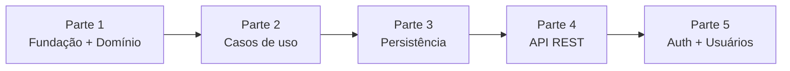

# Plano de Implementação do Backend

Plano de execução do backend do CRM de Atendimento e Orçamentos, dividido em partes entregáveis. A ordem segue a regra de [arquitetura/13-implantacao-ddd-clean-tdd.md](arquitetura/13-implantacao-ddd-clean-tdd.md): **domínio → aplicação → infraestrutura/interface**, sempre em TDD (teste falhando primeiro).

---

## Visão geral

| Parte | Conteúdo | Itens do backlog | Precisa de banco? | Status |
|---|---|---|---|---|
| **1. Fundação + Domínio** | Estrutura de pastas, tooling (pytest, mypy, ruff), teste de arquitetura, Value Objects, enum de estágios, entidades | 0.1, 0.2, 1.1–1.4, 2.1 | Não | ✅ Concluída |
| **2. Casos de uso** | Interfaces de repositório, fakes in-memory, use cases (UC01, 03, 05, 06, 07, 08, 09) | 1.5–1.7, 2.2, 2.4, 2.5, 3.1 | Não | Pendente |
| **3. Persistência** | Config, models SQLAlchemy, Alembic, repositórios Postgres, Docker Compose, testes de integração | 0.4, 1.8, 1.9, 2.7 | Sim | Pendente |
| **4. API REST** | Schemas Pydantic (camelCase), controllers, formato de erro padrão, `main.py`, `/orcamentos/transicoes` | 1.10 + demais rotas | Sim | Pendente |
| **5. Autenticação e usuários** | JWT, hash de senha, perfil Administrador, UC10, teste de carga com 500 orçamentos | 3.3–3.6 | Sim | Pendente |

---

## Parte 1 — Fundação + Domínio

### 1. Estrutura e tooling
- `backend/src/{domain,application,adapters,infra}` com `__init__.py`, conforme [tree.md](tree.md).
- `pyproject.toml` com configuração de **mypy `--strict`**, **ruff** e **pytest** (`pythonpath = src`, imports no formato `from domain.entities.orcamento import Orcamento`).
- Dependências declaradas no próprio `pyproject.toml` (sem `requirements.txt`): grupo `dev` com `pytest`, `mypy`, `ruff`, instalado via `pip install --group dev`. FastAPI e SQLAlchemy entram em `dependencies` nas Partes 3 e 4.
- `pytest.ini` com os marcadores `unit`, `integration` e `e2e`.

### 2. Teste de arquitetura (RNF03) — escrito primeiro
- `tests/unit/test_arquitetura.py` percorre `domain/` e `application/` via `ast` e **falha** se encontrar import de `fastapi`, `sqlalchemy`, `pydantic`, `alembic`, `jose` ou `passlib`.

### 3. Domínio (TDD)

**Exceções** — `domain/exceptions.py`

| Exceção | Uso |
|---|---|
| `ErroDominio` | Base; carrega `mensagem` e `campo` (mapeia direto para o JSON de erro da API) |
| `TransicaoInvalida` | Par origem→destino proibido ou guarda de valor violada (RF02/RF03) |
| `FormatoInvalido` | Telefone ou e-mail inválido (RF09) |
| `ValorInvalido` | Valor orçado zero ou negativo (RN06) |

**Value Objects** — `@dataclass(frozen=True)`, validados na construção

| VO | Regra | Ref. |
|---|---|---|
| `Telefone` | Remove máscara; 10 ou 11 dígitos com DDD; armazena só dígitos | RN04 |
| `Email` | Formato `local@dominio.tld`, normalizado para minúsculas | RN05 |
| `ValorOrcado` | `Decimal` > 0, duas casas decimais | RN06 |
| `EstagioAtendimento` | Enum de 5 valores + mapa `TRANSICOES_PERMITIDAS` + `eh_terminal()` | RN01 |
| `TipoInteracao` | Enum `MENSAGEM`, `LIGACAO`, `REUNIAO` | RF04 |

**Entidades**

| Entidade | Responsabilidades |
|---|---|
| `Orcamento` (aggregate root) | `Orcamento.abrir(cliente_id)` → nasce em NOVO_CONTATO; `mover_estagio()` valida sequência + guarda de valor e preenche `data_fechamento` em FECHADO/PERDIDO (RN03); `definir_valor()`; `registrar_interacao()`; `esta_em_aberto()` |
| `Interacao` | Imutável; criada somente via `Orcamento.registrar_interacao()` |
| `Cliente` | Só existe com `Telefone` e `Email` válidos |
| `Usuario` / `Administrador` | Herança; atributos `perfil` e `ativo` |

### 4. Testes de unidade
- Todos os **25 pares origem→destino** da máquina de estados ([10-diagrama-estados.md](arquitetura/10-diagrama-estados.md)), parametrizados.
- Guarda `[valorDefinido]` para ORCAMENTO_ENVIADO e FECHADO.
- Estados terminais não podem ser reabertos; `data_fechamento` correta.
- Formatos válidos e inválidos de `Telefone`, `Email` e `ValorOrcado`.

### Critério de pronto
- [x] `pytest` verde (114 testes)
- [x] `mypy --strict` limpo (src + tests)
- [x] Teste de arquitetura falha ao inserir `import fastapi` em `domain/`

### Decisões de projeto (sujeitas a veto)
1. **Métodos em `snake_case`** (`mover_estagio`), seguindo a convenção do backend em [especificacoes_tecnicas.md](especificacoes_tecnicas.md) §7. Os diagramas usam `moverEstagio`.
2. **Data/hora injetada como parâmetro** — `mover_estagio(novo, hoje)` e `registrar_interacao(..., agora)` em vez de `date.today()` dentro do domínio. Testes determinísticos; o relógio vem do use case.
3. **Interação em orçamento Fechado/Perdido é permitida** — registrar um contato pós-fechamento faz sentido de negócio. A documentação não define; bloquear é uma linha.

---

## Parte 2 — Casos de uso (resumo)
- Interfaces `ClienteRepository`, `OrcamentoRepository`, `UsuarioRepository` em `domain/repositories/` (ABC/Protocol).
- Fakes in-memory em `tests/` para todos os use cases (RNF06).
- Use cases: `RegistrarNovoContato`, `MoverEstagio`, `DefinirValor`, `RegistrarInteracao`, `ConsultarOrcamentos`, `ConsultarMetricas`, `ConsultarHistoricoCliente`.
- Teste-chave (RNF04): `salvar()` **não** é chamado quando o domínio rejeita.

## Parte 3 — Persistência (resumo)
- `infra/config.py`, `infra/db/session.py`, `infra/db/models.py` (models ORM **separados** das entidades).
- Migration inicial Alembic com CHECK de estágio, `ON DELETE CASCADE` em `interacao`, `ON DELETE RESTRICT` em `orcamento.cliente_id` e índices.
- Repositórios `*RepositoryPostgres` com mapeamento model ↔ entidade.
- `docker-compose.yml` com PostgreSQL 16; testes de integração de round-trip do agregado.

## Parte 4 — API REST (resumo)
- Schemas Pydantic de entrada/saída em camelCase.
- Controllers para as rotas de [especificacoes_tecnicas.md](especificacoes_tecnicas.md) §4, incluindo `GET /orcamentos/transicoes`.
- Handler global: `ErroDominio` → 422 no formato `{erro, mensagem, campo}`.
- `main.py` como composition root; testes de rota (200 válido / 422 inválido).

## Parte 5 — Autenticação e usuários (resumo)
- `infra/security.py` com JWT e hash de senha.
- Dependência de autenticação em todas as rotas exceto login; autorização por perfil Administrador.
- `GerenciarUsuariosUseCase` (auto-desativação bloqueada).
- Teste de carga do painel com 500 orçamentos (RNF01, < 2 s).

---

## Pré-requisitos de ambiente

| Item | Situação atual | Necessário a partir de |
|---|---|---|
| Python | Apenas 3.14 **32-bit** via `py`; `python` fora do PATH | Parte 1 roda; para Partes 3–4 recomenda-se **3.12/3.13 64-bit** (wheels do `psycopg`) |
| Docker | Não instalado | Parte 3 (PostgreSQL) — ou instalar o PostgreSQL nativo |
