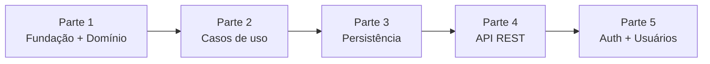

# Plano de Implementação do Backend

Plano de execução do backend do CRM de Atendimento e Orçamentos, dividido em partes entregáveis. A ordem segue a regra de [arquitetura/13-implantacao-ddd-clean-tdd.md](arquitetura/13-implantacao-ddd-clean-tdd.md): **domínio → aplicação → infraestrutura/interface**, sempre em TDD (teste falhando primeiro).

---

## Visão geral

| Parte | Conteúdo | Itens do backlog | Precisa de banco? | Status |
|---|---|---|---|---|
| **1. Fundação + Domínio** | Estrutura de pastas, tooling (pytest, mypy, ruff), teste de arquitetura, Value Objects, enum de estágios, entidades | 0.1, 0.2, 1.1–1.4, 2.1 | Não | ✅ Concluída |
| **2. Casos de uso** | Interfaces de repositório, fakes in-memory, use cases (UC01, 03, 05, 06, 07, 08, 09) | 1.5–1.7, 2.2, 2.4, 2.5, 3.1 | Não | ✅ Concluída |
| **3. Persistência** | Config, models SQLAlchemy, Alembic, repositórios Postgres, Docker Compose, testes de integração | 0.4, 1.8, 1.9, 2.7 | Sim | ✅ Concluída (SQLite e PostgreSQL/Supabase) |
| **4. API REST** | Schemas Pydantic (camelCase), controllers, formato de erro padrão, `main.py`, `/orcamentos/transicoes` | 1.10 + demais rotas | Sim | ✅ Concluída |
| **5. Autenticação e usuários** | JWT, hash de senha, perfil Administrador, UC10, teste de carga com 500 orçamentos | 3.3–3.6 | Sim | ✅ Concluída |



---

## Parte 1 — Fundação + Domínio

### 1. Estrutura e tooling
- `backend/src/{domain,application,adapters,infra}` com `__init__.py`, conforme [tree.md](tree.md).
- `pyproject.toml` com configuração de **mypy `--strict`**, **ruff** e **pytest** (`pythonpath = src`, imports no formato `from domain.entities.orcamento import Orcamento`).
- Dependências declaradas no próprio `pyproject.toml` (sem `requirements.txt`): grupo `dev` com `pytest`, `mypy`, `ruff`, instalado via `pip install --group dev`. FastAPI e SQLAlchemy entram em `dependencies` nas Partes 3 e 4.
- `pytest.ini` com os marcadores `unit`, `integration` e `e2e`.

### 2. Teste de arquitetura (RNF03) — escrito primeiro
- `tests/unit/test_arquitetura.py` percorre `domain/` e `application/` via `ast` e **falha** se encontrar import de `fastapi`, `sqlalchemy`, `pydantic`, `alembic`, `jose` ou `passlib`.

### 3. Domínio (TDD)

**Exceções** — `domain/exceptions.py`

| Exceção | Uso |
|---|---|
| `ErroDominio` | Base; carrega `mensagem` e `campo` (mapeia direto para o JSON de erro da API) |
| `TransicaoInvalida` | Par origem→destino proibido ou guarda de valor violada (RF02/RF03) |
| `FormatoInvalido` | Telefone ou e-mail inválido (RF09) |
| `ValorInvalido` | Valor orçado zero ou negativo (RN06) |

**Value Objects** — `@dataclass(frozen=True)`, validados na construção

| VO | Regra | Ref. |
|---|---|---|
| `Telefone` | Remove máscara; 10 ou 11 dígitos com DDD; armazena só dígitos | RN04 |
| `Email` | Formato `local@dominio.tld`, normalizado para minúsculas | RN05 |
| `ValorOrcado` | `Decimal` > 0, duas casas decimais | RN06 |
| `EstagioAtendimento` | Enum de 5 valores + mapa `TRANSICOES_PERMITIDAS` + `eh_terminal()` | RN01 |
| `TipoInteracao` | Enum `MENSAGEM`, `LIGACAO`, `REUNIAO` | RF04 |

**Entidades**

| Entidade | Responsabilidades |
|---|---|
| `Orcamento` (aggregate root) | `Orcamento.abrir(cliente_id)` → nasce em NOVO_CONTATO; `mover_estagio()` valida sequência + guarda de valor e preenche `data_fechamento` em FECHADO/PERDIDO (RN03); `definir_valor()`; `registrar_interacao()`; `esta_em_aberto()` |
| `Interacao` | Imutável; criada somente via `Orcamento.registrar_interacao()` |
| `Cliente` | Só existe com `Telefone` e `Email` válidos |
| `Usuario` / `Administrador` | Herança; atributos `perfil` e `ativo` |

### 4. Testes de unidade
- Todos os **25 pares origem→destino** da máquina de estados ([10-diagrama-estados.md](arquitetura/10-diagrama-estados.md)), parametrizados.
- Guarda `[valorDefinido]` para ORCAMENTO_ENVIADO e FECHADO.
- Estados terminais não podem ser reabertos; `data_fechamento` correta.
- Formatos válidos e inválidos de `Telefone`, `Email` e `ValorOrcado`.

### Critério de pronto
- [x] `pytest` verde (114 testes)
- [x] `mypy --strict` limpo (src + tests)
- [x] Teste de arquitetura falha ao inserir `import fastapi` em `domain/`

### Decisões de projeto (sujeitas a veto)
1. **Métodos em `snake_case`** (`mover_estagio`), seguindo a convenção do backend em [especificacoes_tecnicas.md](especificacoes_tecnicas.md) §7. Os diagramas usam `moverEstagio`.
2. **Data/hora injetada como parâmetro** — `mover_estagio(novo, hoje)` e `registrar_interacao(..., agora)` em vez de `date.today()` dentro do domínio. Testes determinísticos; o relógio vem do use case.
3. **Interação em orçamento Fechado/Perdido é permitida** — registrar um contato pós-fechamento faz sentido de negócio. A documentação não define; bloquear é uma linha.

---

## Parte 2 — Casos de uso

### 1. Portas (interfaces) — `domain/repositories/`
Classes abstratas (`ABC`), uma por aggregate root:

| Interface | Métodos |
|---|---|
| `ClienteRepository` | `salvar`, `buscar_por_id`, `listar_por_ids` |
| `OrcamentoRepository` | `salvar` (agregado inteiro, com interações), `buscar_por_id`, `listar_todos`, `listar_por_cliente` |
| `UsuarioRepository` | `salvar`, `buscar_por_id`, `buscar_por_email`, `listar_todos` |

### 2. Repositórios em memória — `adapters/repositories/em_memoria.py`
- Guardam e devolvem **cópias** (`deepcopy`), imitando um banco: alterar um objeto carregado não persiste nada sem `salvar()`.
- Contam `salvamentos`, o que permite verificar RNF04 (“`salvar()` não é chamado quando o domínio rejeita”).
- Ficam em `src/` (não só nos testes) porque são um adapter legítimo; os testes de contrato (hoje em `tests/integration/test_contrato_repositorios.py`) rodam contra todas as implementações.

### 3. Casos de uso — `application/use_cases/`

| Caso de uso | UC / RF | Entrada → Saída |
|---|---|---|
| `RegistrarNovoContatoUseCase` | UC01, UC02 / RF01, RF09 | `DadosNovoContato` → `ContatoRegistrado(cliente, orcamento)` |
| `MoverEstagioUseCase` | UC03, UC04 / RF02, RF03 | `orcamento_id, EstagioAtendimento` → `Orcamento` |
| `DefinirValorUseCase` | UC05 / RF03 | `orcamento_id, Decimal` → `Orcamento` |
| `RegistrarInteracaoUseCase` | UC06 / RF04 | `orcamento_id, TipoInteracao, conteudo` → `Interacao` |
| `ConsultarOrcamentosUseCase` | UC07 / RF05 | → `Painel` (5 colunas de `CardOrcamento`, projeção enxuta) |
| `ConsultarMetricasUseCase` + `calcular_metricas()` | UC08 / RF06, RN07 | → `MetricasFunil(em_aberto, fechados, perdidos, taxa_fechamento)` |
| `ConsultarClienteUseCase` | UC09 / RF08 | `cliente_id` → `ClienteComOrcamentos` |
| `ConsultarHistoricoClienteUseCase` | UC09 / RF07, RN08 | `cliente_id` → `list[ItemHistorico]` em ordem cronológica |

Apoio: `application/relogio.py` (tipo `Relogio = Callable[[], datetime]`), `application/exceptions.py` (`ClienteNaoEncontrado`, `OrcamentoNaoEncontrado` → 404 na API) e `use_cases/comum.py` (carregar ou lançar não encontrado).

### Critério de pronto
- [x] `pytest` verde (160 testes, nenhum usa banco — RNF06)
- [x] `mypy --strict` e `ruff` limpos
- [x] Transição rejeitada não chama `salvar()` (RNF04)
- [x] Teste de arquitetura continua passando para `application/`

### Decisões de projeto
1. **Relógio injetado como função** (`Relogio`), não como classe: nos testes é `lambda: AGORA`; em produção, `lambda: datetime.now(UTC)`.
2. **Transação por requisição** (Parte 3/4): os repositórios Postgres compartilham a mesma sessão por requisição; o commit acontece ao final dela, e qualquer exceção faz rollback. Por isso UC01 não precisa de uma “Unit of Work” explícita.
3. **Taxa de fechamento** é um percentual com duas casas (`Decimal("66.67")`), e `None` quando não há orçamento concluído (RN07).
4. **Cards do painel** ordenados por `data_abertura` crescente (quem espera há mais tempo primeiro).
5. **`ConsultarClienteUseCase`** foi acrescentado para atender `GET /clientes/{id}` (cliente + orçamentos), separado do histórico.

## Parte 3 — Persistência

### 1. Infraestrutura — `src/infra/`
| Arquivo | Conteúdo |
|---|---|
| `config.py` | `Configuracao` (pydantic-settings): lê `DATABASE_URL`, `JWT_*`, `CORS_ORIGINS`... do ambiente ou do `.env` |
| `db/models.py` | Models ORM `UsuarioModel`, `ClienteModel`, `OrcamentoModel`, `InteracaoModel` — **separados** das entidades. Tipo `DataHoraUTC` grava em UTC e devolve sempre com fuso |
| `db/session.py` | `criar_engine`, `criar_fabrica_sessoes` e `sessao_transacional` (commit no fim, rollback em qualquer erro) |

### 2. Repositórios — `src/adapters/repositories/*_postgres.py`
`ClienteRepositoryPostgres`, `OrcamentoRepositoryPostgres` e `UsuarioRepositoryPostgres` implementam as mesmas interfaces da Parte 2. Traduzem model ↔ entidade, não fazem commit (a transação pertence à requisição) e são escritos em SQLAlchemy portável: PostgreSQL em produção, SQLite nos testes.

### 3. Migration — `backend/alembic/`
`0001_esquema_inicial.py` cria as 4 tabelas do DER com: UUID, `TIMESTAMP WITH TIME ZONE`, CHECK de `estagio`/`tipo`/`perfil`, `valor` nullable, `ON DELETE RESTRICT` (cliente) e `ON DELETE CASCADE` (interação), e-mail de usuário único e os 3 índices de RNF01. Uso (PowerShell, em `backend/`): `.\.venv\Scripts\python.exe -m alembic upgrade head` (ou `--sql` para só gerar o SQL).

### 4. Docker — raiz do projeto
`docker-compose.yml` com PostgreSQL e `docker/postgres/init.sql`, que cria também o banco `crm_test`. Depois ampliado para subir também a API — ver “Docker: banco + API”.

### 5. Testes de integração — `tests/integration/`
| Arquivo | O que prova |
|---|---|
| `test_contrato_repositorios.py` | 12 cenários × 3 implementações (memória, SQLite, PostgreSQL): round-trip do agregado, atualização sem duplicar, perfil do usuário... |
| `test_integridade_banco.py` | RNF08: RESTRICT, CASCADE, CHECKs e e-mail único garantidos pelo próprio banco |
| `test_transacao.py` | UC01 é tudo-ou-nada: se a 2ª gravação falha, a 1ª é desfeita |
| `test_migracao.py` | A migration cria as tabelas e os índices, bate com os models e o downgrade limpa tudo |

As variantes PostgreSQL rodam quando `TEST_DATABASE_URL` está definida; sem ela são puladas.

### Critério de pronto
- [x] `pytest` verde: 188 testes (23 pulados — variantes PostgreSQL)
- [x] `mypy --strict` e `ruff` limpos
- [x] SQL da migration gerado no dialeto PostgreSQL conferido contra o DER (`alembic upgrade head --sql`)
- [x] Testes de integração executados contra PostgreSQL real (Supabase, PostgreSQL 17) — ver “Banco de dados: Supabase”

### Decisões de projeto
1. **Nomes `*RepositoryPostgres`** mantidos como na documentação, embora o código seja SQLAlchemy portável.
2. **SQLite como banco de teste sempre disponível**, para que a suíte rode em qualquer máquina; PostgreSQL como validação final.
3. **Valores dos enums fixos na migration**: uma migration é um retrato do esquema e não deve mudar se o enum mudar depois.
4. **Interações só são acrescentadas** ao salvar o orçamento — são imutáveis (Parte 1), então nunca há update/delete de interação pelo repositório.

## Parte 4 — API REST

### 1. Rotas — `src/adapters/controllers/` (base `/api/v1`)
| Método | Rota | Caso de uso | Sucesso | Erros |
|---|---|---|---|---|
| `POST` | `/clientes` | UC01 | 201 + cliente e orçamento | 422 |
| `GET` | `/clientes/{id}` | UC09 | 200 + cliente com orçamentos | 404 |
| `GET` | `/clientes/{id}/historico` | UC09 | 200 + interações em ordem cronológica | 404 |
| `GET` | `/orcamentos` | UC07 | 200 + 5 colunas de cards | — |
| `GET` | `/orcamentos/transicoes` | apoio ao Kanban | 200 + `transicoes` e `exigemValor` | — |
| `PATCH` | `/orcamentos/{id}/estagio` | UC03 | 200 + orçamento | 404, 422 `TransicaoInvalida` |
| `PATCH` | `/orcamentos/{id}/valor` | UC05 | 200 + orçamento | 404, 422 `ValorInvalido` |
| `POST` | `/orcamentos/{id}/interacoes` | UC06 | 201 + interação | 404, 422 |
| `GET` | `/metricas/funil` | UC08 | 200 + métricas | — |

Documentação interativa automática em `/docs` (Swagger) e `/openapi.json`.

### 2. Peças
| Arquivo | Papel |
|---|---|
| `adapters/schemas/*.py` | Pydantic de entrada e saída; JSON em camelCase; `InstanteUTC` faz todo horário sair em UTC |
| `adapters/controllers/dependencias.py` | Uma sessão (transação) por requisição, compartilhada pelos repositórios; relógio da aplicação |
| `adapters/controllers/erros.py` | Formato único de erro `{erro, mensagem, campo}`: `ErroDominio` → 422, `RecursoNaoEncontrado` → 404, JSON fora do contrato → 422 `DadosInvalidos` |
| `main.py` | Composition root: `criar_app()` liga CORS, rotas, tratadores de erro, banco (só ao subir o servidor) e relógio no fuso do negócio |

Rodar o servidor: o jeito padrão é pelo Docker (`docker compose up --build` na raiz — ver “Docker: banco + API”). Para desenvolver com recarga automática, dá para rodar pelo `.venv` (PowerShell, dentro de `backend/`), usando o banco do `.env`:
```powershell
.\.venv\Scripts\python.exe -m uvicorn main:app --app-dir src --reload
```
Para usar um SQLite local, sem banco nenhum rodando, defina antes, na mesma janela:
```powershell
$env:DATABASE_URL = "sqlite:///./crm_dev.db"
.\.venv\Scripts\python.exe -m alembic upgrade head
```

### 3. Testes
- `tests/integration/test_api_*.py`: 9 rotas, caminhos de sucesso e de erro, CORS e OpenAPI — rodam em SQLite e, com `TEST_DATABASE_URL`, em PostgreSQL.
- `tests/e2e/test_fluxo_funil.py`: do primeiro contato ao fechamento pela API, conferindo painel, métricas e histórico.
- `tests/relogio_de_teste.py`: relógio parado que o teste pode adiantar.

### Critério de pronto
- [x] `pytest` verde: 225 testes (58 pulados — variantes PostgreSQL)
- [x] `mypy --strict` e `ruff` limpos
- [x] `PATCH /orcamentos/{id}/estagio` → 200 na transição válida e 422 na inválida (item 7 do TDD)
- [x] Servidor real (uvicorn + banco criado pela migration) respondendo pelo `curl`

### Decisões de projeto
1. **`GET /orcamentos/transicoes` devolve também `exigemValor`**: o Kanban precisa saber quais colunas pedem valor para avisar antes de soltar o card, sem reimplementar a regra.
2. **Erros de formato do JSON** (campo ausente, enum desconhecido) usam o mesmo formato de erro, com `erro: "DadosInvalidos"`.
3. **Data do negócio no fuso local** (`FUSO_HORARIO`, padrão `America/Sao_Paulo`): às 22h em Brasília já é o dia seguinte em UTC, e o orçamento não pode “nascer amanhã”. Horários continuam gravados e devolvidos em UTC.
4. **Interações com o mesmo horário exato** não têm ordem garantida pelo banco; os testes simulam o tempo passando entre contatos (`RelogioDeTeste.avancar`).
5. **Rotas protegidas na Parte 5**: todas exigem `Authorization: Bearer`, exceto o login.

## Parte 5 — Autenticação e usuários

### 1. Rotas novas (base `/api/v1`)
| Método | Rota | Quem pode | Sucesso | Erros |
|---|---|---|---|---|
| `POST` | `/auth/login` | qualquer um | 200 + `accessToken`, `expiraEm`, `usuario` | 401 `CredenciaisInvalidas` |
| `GET` | `/auth/eu` | logado | 200 + usuário logado | 401 |
| `GET` | `/usuarios` | Administrador | 200 + lista | 401, 403 |
| `POST` | `/usuarios` | Administrador | 201 | 401, 403, 409 e-mail repetido, 422 senha curta |
| `PATCH` | `/usuarios/{id}` | Administrador | 200 | 401, 403, 404, 409, 422 auto-desativação |

Todas as rotas do CRM (Parte 4) passaram a exigir `Authorization: Bearer <token>`; sem token válido → 401 `NaoAutenticado` com `WWW-Authenticate: Bearer`. O `/docs` mostra o botão **Authorize** para colar o token.

### 2. Peças
| Camada | Arquivo | Papel |
|---|---|---|
| domínio | `entities/usuario.py` | `atualizar_cadastro()`; `Administrador.definir_perfil()` (não pode mudar o próprio perfil) |
| aplicação | `portas.py` | Porta `HashDeSenha` (gerar/conferir) |
| aplicação | `use_cases/autenticar_usuario.py` | Confere e-mail e senha; toda falha tem a mesma resposta, e o tempo é igual com e-mail inexistente |
| aplicação | `use_cases/gerenciar_usuarios.py` | UC10: listar, criar, editar; só Administrador ativo (a checagem fica no caso de uso, não só na rota); senha ≥ 8; e-mail único; `criar_primeiro_administrador` |
| infra | `security.py` | `HashScrypt` (scrypt da biblioteca padrão, com sal) e `EmissorJWT` (validade conferida pelo relógio da aplicação) |
| adapters | `auth_controller.py`, `usuario_controller.py`, `dependencias.py` | Login, `/auth/eu`, rotas de usuários e `obter_usuario_logado` (recarrega o usuário a cada requisição) |
| raiz | `criar_administrador.py` | Script do primeiro administrador (a senha é pedida no terminal) |

Primeiro acesso (dentro de `backend/`):
```
.\.venv\Scripts\python.exe src\criar_administrador.py --nome "Dona Maria" --email maria@empresa.com
```

### 3. Testes
- Unidade: domínio do usuário, login (5 falhas possíveis, mesma resposta), UC10 (autorização, senha, e-mail único, auto-desativação, perfil), scrypt e JWT (expiração, assinatura, token lixo).
- Integração: login, as rotas exigindo token, token expirado, usuário desativado perdendo o acesso na hora, 403 para usuário comum, 409, script do primeiro administrador.
- **Carga (RNF01)**: painel com 500 orçamentos e 1.500 interações — limite 2 s, medido **~50–80 ms**.
- E2E: o atendente faz login de verdade e precisa entrar de novo quando o token expira.

### Critério de pronto
- [x] `pytest` verde: 300 testes (90 pulados — variantes PostgreSQL)
- [x] `mypy --strict` e `ruff` limpos
- [x] Rotas do CRM exigem token; gestão de usuários nega perfil comum (RNF07)
- [x] Senhas guardadas só como hash (scrypt com sal)
- [x] Painel com 500 orçamentos abaixo de 2 s (RNF01)
- [x] Servidor real: primeiro administrador criado, login, rota protegida e criação de usuário pelo `curl`

### Decisões de projeto
1. **scrypt (biblioteca padrão) em vez de bcrypt/argon2**: mesma categoria de segurança e não depende de DLL compilada (que o Smart App Control bloquearia). Os parâmetros ficam gravados no hash, permitindo aumentar o custo no futuro.
2. **Token sem estado de sessão, mas usuário recarregado a cada requisição**: desativar um usuário corta o acesso na hora, sem esperar o token expirar.
3. **Autorização dentro do caso de uso** (`AcessoNegado`), não só na rota.
4. **Administrador não muda o próprio perfil nem se desativa**: evita um sistema sem nenhum administrador.
5. **Primeiro administrador por script**, que só funciona com o cadastro vazio — não existe rota pública de cadastro.
6. **Segredo JWT padrão recusado em produção** (`ENVIRONMENT=production`): a API não sobe sem um `JWT_SECRET` próprio.
7. **Validade do token: 8 horas** (`JWT_EXPIRATION_MINUTES=480`), um turno de trabalho.

---

## Docker: banco + API

O ambiente padrão do projeto (RNF09). Na raiz, com o Docker Desktop aberto:

```powershell
docker compose up --build        # PostgreSQL + API; Swagger em http://localhost:8000/docs
docker compose run --rm testes   # testes com cobertura; relatório em backend\htmlcov\index.html
docker compose exec api python src/criar_administrador.py --nome "Seu Nome" --email voce@email.com
docker compose down              # para tudo (os dados ficam no volume; "down -v" apaga)
```

| Peça | O que faz |
|---|---|
| `docker-compose.yml` (raiz) | Orquestra 4 serviços: `db` (PostgreSQL 17), `api` (backend), `pgadmin` (banco pelo navegador em http://localhost:5050, com o servidor "CRM (Docker)" já cadastrado por `docker/pgadmin/servers.json`; login com `PGADMIN_EMAIL`/`PGADMIN_PASSWORD` do `.env`, padrão `admin@crm.com`/`admin123`; senha do PostgreSQL `crm`) e `testes` (só sobe com `run`, pelo *profile* `testes`). A API espera o banco ficar saudável antes de subir |
| `backend/Dockerfile` | Imagem `python:3.14-slim` com dois alvos: **`api`** (aplica as migrations pendentes com `alembic upgrade head` e sobe o uvicorn na porta 8000, com usuário sem privilégio de root) e **`testes`** (acrescenta o grupo `dev` e roda `pytest --cov`) |
| `backend/.dockerignore` | Deixa `.venv`, caches, `htmlcov` e `.env` fora da imagem |
| `docker/postgres/init.sql` | Cria o banco `crm_test` na primeira subida (os testes apagam e recriam as tabelas dele) |
| Variáveis | Lidas do `.env` da raiz (`POSTGRES_PASSWORD`, `JWT_SECRET`, `CORS_ORIGINS`...), com padrões de desenvolvimento. Dentro do Docker, a `DATABASE_URL` aponta para o serviço `db`, não para `localhost` |

As dependências da imagem saem do `[project].dependencies` do `pyproject.toml`, que continua sendo a única lista. O banco também fica exposto em `127.0.0.1:5432` (só nesta máquina), para rodar a API ou os testes pelo `.venv` com as URLs do `.env.example`.

---

## Banco de dados: Supabase (alternativa sem Docker)

Usado durante o desenvolvimento das Partes 3 a 5, antes de o Docker ser instalado. Continua funcionando: basta colocar a URL do Supabase no `.env`.

Configuração usada: **Supabase** (plano gratuito, região São Paulo, PostgreSQL 17).

| Item | Como ficou |
|---|---|
| Driver | **pg8000** (Python puro): funciona no Python 32 bits e sem DLL. `infra/db/session.py::preparar_conexao` aceita a URL copiada do Supabase (`postgresql://...?sslmode=require`), troca para o pg8000 e liga o TLS |
| Conexão | *Session pooler* (IPv4, porta 5432). A conexão direta do plano grátis só funciona em IPv6 |
| Criptografia | TLS 1.3 conferido no socket. `sslmode=require` criptografa, mas não confere o certificado do servidor |
| Bancos | `postgres` (aplicação, `DATABASE_URL`) e `crm_test` (testes, `TEST_DATABASE_URL`) — os testes apagam e recriam tabelas; há uma trava que falha se as duas URLs forem iguais |
| Segredos | No `.env` da raiz do projeto, que está no `.gitignore` |
| API automática do Supabase | Fechada pela migration `0002`: RLS ligado em todas as tabelas e permissões dos papéis públicos `anon`/`authenticated` revogadas (inclusive para tabelas futuras). Sem isso, a chave pública `anon` daria leitura e escrita em tudo, inclusive nos hashes de senha. O backend conecta como dono das tabelas e não é afetado |

Resultados no Supabase: migrations `0001` e `0002` aplicadas; **399 testes passando, nenhum pulado** (~2 min, pela latência até São Paulo); painel com 500 orçamentos em **330–370 ms** (limite de 2 s).

Particularidade do pg8000: violações de CHECK e FOREIGN KEY chegam como `ProgrammingError` (só UNIQUE vira `IntegrityError`). Os testes de integridade conferem o SQLSTATE (classe `23`), que vale para qualquer driver.

---

## Cobertura de testes

Medida com **pytest-cov** (grupo `dev` do `pyproject.toml`), contando só o código de `src/` e também os desvios (`if`/`else`), não apenas as linhas. Para gerar, no PowerShell:

```powershell
cd backend
.\.venv\Scripts\python.exe -m pytest --cov --cov-report=term-missing --cov-report=html
start htmlcov\index.html
```

- **Terminal:** tabela com o percentual por arquivo; a coluna `Missing` lista as linhas que nenhum teste executou.
- **`backend/htmlcov/index.html`:** o mesmo relatório no navegador, com o código colorido (verde testado, vermelho não testado, amarelo `if` com só um caminho testado). A pasta é gerada a cada execução e está no `.gitignore`.

Resultado: **100%** de linhas e desvios em `src/` (423 testes passando, 1 pulado — a variante SQLite do teste de RLS). A meta do projeto é **80%**: o `pyproject.toml` define `fail_under = 80`, e o comando falha se a cobertura cair abaixo disso. O único trecho excluído é o `if __name__ == "__main__":` do `criar_administrador.py` (a função `main()` dele é testada).

---

## Pré-requisitos de ambiente

| Item | Situação atual | Necessário a partir de |
|---|---|---|
| Python | Apenas 3.14 **32-bit** via `py`; `python` fora do PATH | Suficiente: o driver pg8000 é Python puro |
| Docker Desktop (com WSL 2) | Não instalados; virtualização já ativa | Ambiente padrão (RNF09). Instalação: `wsl --install` no PowerShell como administrador, reiniciar, instalar o Docker Desktop. Sem Docker, dá para usar o Supabase |
| Smart App Control (Windows) | **Ligado** — bloqueia DLLs compiladas sem reputação (`lxml`, extensões do SQLAlchemy) | O SQLAlchemy foi instalado em modo Python puro: `DISABLE_SQLALCHEMY_CEXT=1 pip install --no-binary sqlalchemy sqlalchemy`. O pydantic funciona |
